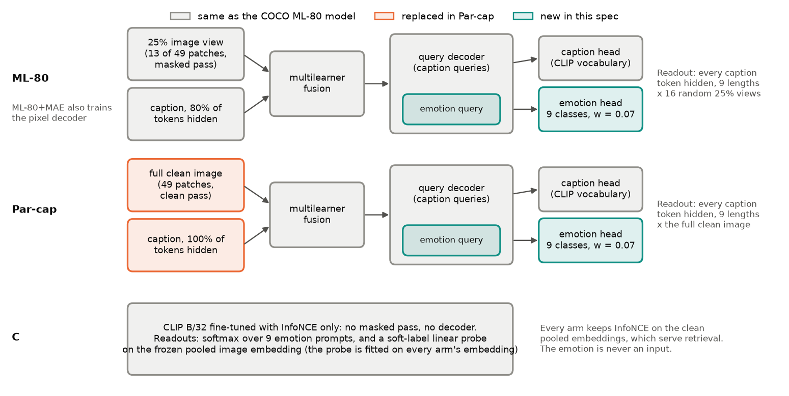
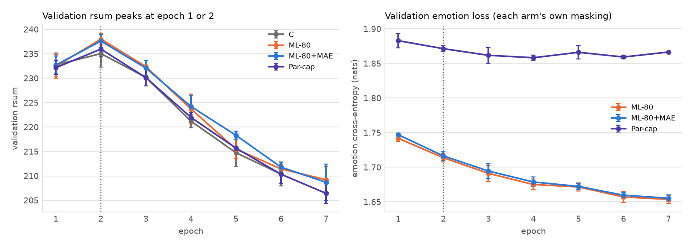
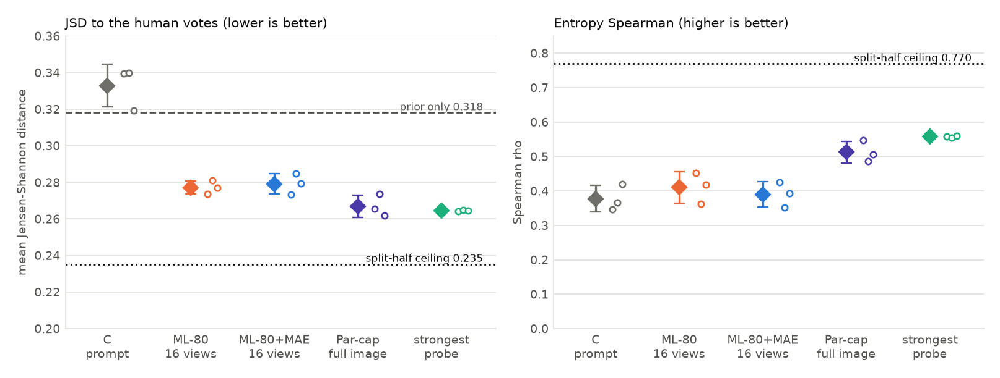
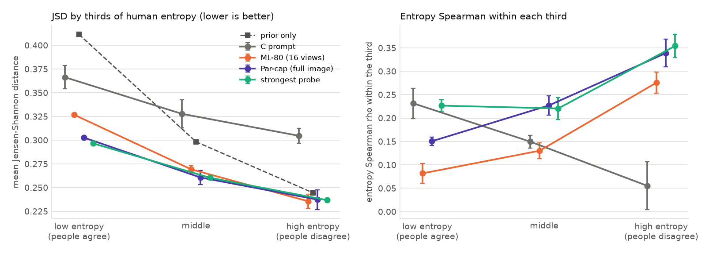
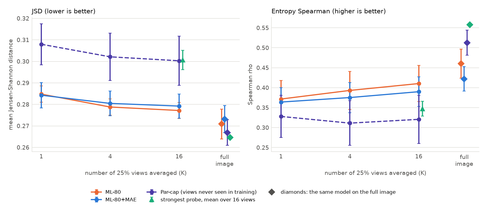
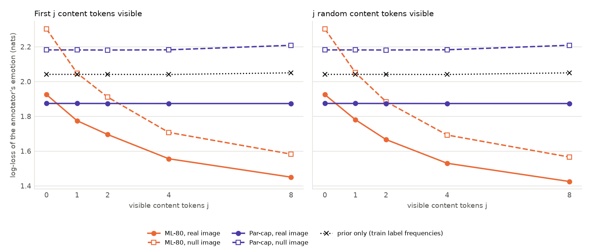
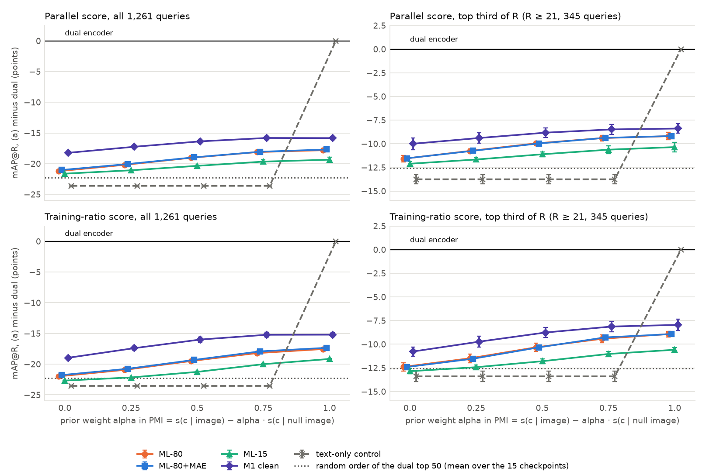
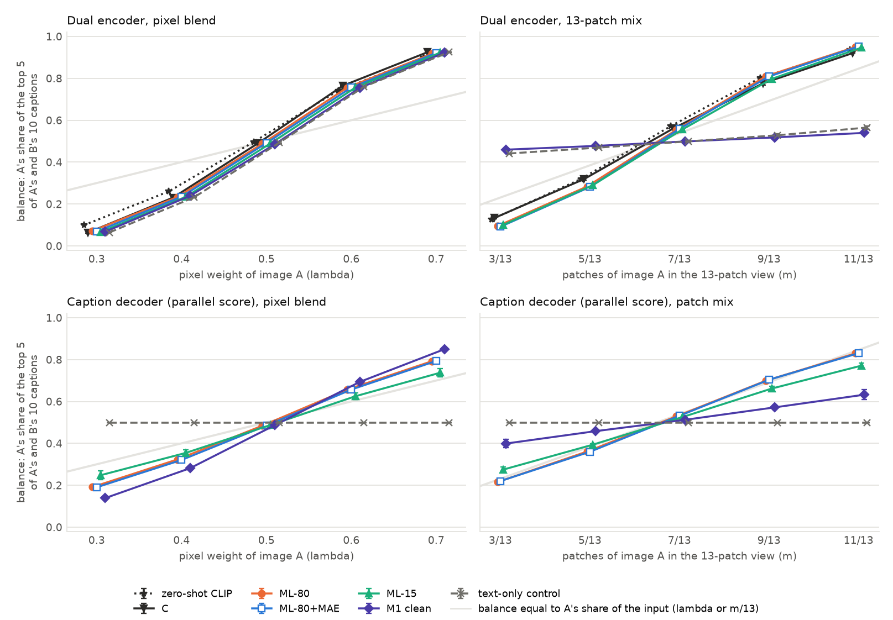
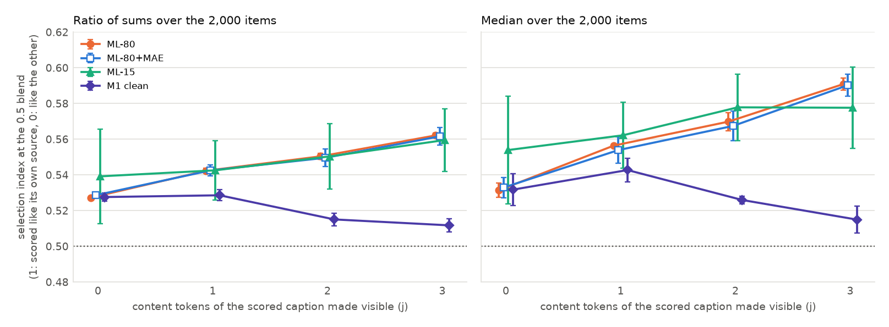

# The masked decoder's emotion distribution did not match dense human votes better than a parallel captioner or a linear probe (D4, pre-registered: H-b not supported); visible caption words steered its emotion slot, a readout that favours masking by construction (D7)

Date: 2026-10-08. Branch `hb-artelingo`. Every training run at commit `6f77ad4` (2026-10-07 18:18), every readout at `acc25ba`, final tables in the registry entry of 2026-10-08 02:00. Design and pre-registered rule: [the H-b first spec](../../../superpowers/specs/2026-10-07-hb-first-artelingo-design.md) (committed 2026-10-07 17:01, amended 18:10), with plans for [the training path](../../../superpowers/plans/2026-10-07-hb-1-training-path.md), [the readouts](../../../superpowers/plans/2026-10-07-hb-2-readouts.md) and [the COCO probes](../../../superpowers/plans/2026-10-07-hb-3-coco-probes.md). Background: [the H-b literature review](2026-10-06_masked_decoder_readings_review.md) and [Stages 1 and 2 of the masking line](2026-10-06_masking_stages_1_2.md). Registry of every decision and run: `tests/20261007_hb/runs.md`. Every number taken from the result files is printed by [`build_2026-10-08_hb_emotion_readout.py`](../../assets/build_2026-10-08_hb_emotion_readout.py), which also draws the figures; numbers quoted from the spec, the registry or earlier reports are cited to them.

## Summary

H-b claims that a cross-modal masked model holds several readings of one image in its decoder's predictive distribution, which a contrastive dual encoder cannot. We tested it for the first time on ArtELingo, with the annotators' emotion label (9 classes) as the reading unit and the non-English ArtELingo-28 votes (1,600 paintings, median 104 votes each, none seen in training) as the human distribution. Four arms were trained on English ArtELingo with 3 seeds each: a contrastive model (C), the masked model at 80% text masking (ML-80), the same with the pixel decoder (ML-80+MAE) and a parallel captioner that reads the full image with every caption token hidden (Par-cap).

1. D4, the main test. The pre-registered verdict is negative: H-b on D4 is not supported. ML-80's emotion distribution had a mean Jensen-Shannon distance (JSD) to the human votes of 0.277 ± 0.004, against 0.267 ± 0.006 for Par-cap and 0.265 ± 0.000 for the strongest soft-label probe on frozen CLIP embeddings. Its entropy Spearman (does the model know which paintings people disagree on?) was 0.410 ± 0.046, against 0.513 ± 0.032 and 0.558 ± 0.003. All four pre-registered differences went against ML-80, and under the pre-registered hierarchical bootstrap all four intervals excluded zero (Holm p = 0.0034 for JSD against Par-cap, below 0.0001 for the other three). With 3 seeds per arm those tails come mostly from resampling paintings: a seed-level Welch test on the per-seed metrics gave Holm p = 0.105 for each comparison. The data show that ML-80 is not better than either comparator, and only suggest that it is worse.
2. Against the floor and the ceiling, every decoder beat the prior-only model (JSD 0.318) and C's prompt softmax (0.333, worse than the prior on JSD), and all stayed far from the split-half human ceiling (JSD 0.235, entropy Spearman 0.770). Of the prior-to-ceiling JSD gap, ML-80 closed 49%, Par-cap 62% and the strongest probe 65%.
3. Why ML-80 trailed: its readout stayed closer to the prior (mean JSD to the prior 0.200, against 0.233 for Par-cap, 0.247 for the probe and 0.317 for the human targets), and its shortfall sat on the paintings where people agree (lowest third of human entropy: JSD +0.024 against Par-cap; highest third: −0.002). Reading the full image instead of the pre-registered 16 random 25% views narrowed the JSD gap to within seed noise (0.271 against Par-cap's 0.267, seed-level Welch p = 0.50), while entropy Spearman stayed 0.05 lower (0.461 against 0.513, p = 0.14). A linear probe on any arm's frozen image embedding, ML-80's own included, reached JSD 0.265 and entropy Spearman 0.543 to 0.558: the pooled embedding already carries the painting-level emotion distribution, and no decoder added to it. The pixel decoder changed nothing (ML-80+MAE minus ML-80: JSD +0.002, p = 0.53).
4. D6, view sampling. Averaging more 25% views helped ML-80 (JSD 0.285 at 1 view, 0.277 at 16), but the full image was better still (0.271). The views disagreed more on paintings that people disagree on (Spearman of the between-view mutual information with human entropy 0.177 [0.118, 0.236]), so the review's kill rule did not fire. Par-cap's views showed no such correlation (−0.033), and with ML-80's own readout entropy held fixed, ML-80's correlation fell to 0.030 [−0.020, 0.082]. View disagreement mostly restates D4's entropy ranking, on which ML-80 trailed Par-cap, and adds no view-specific signal.
5. D7, partial captions. Visible content tokens moved ML-80's emotion slot toward the annotator's own label: log-loss 1.925 with none visible and 1.450 with the first 8, against 2.041 for the prior-only model on the same captions. The real image beat a null image at every number of visible tokens (−0.377 to −0.132 nats, all intervals below zero), so the review's kill rule did not fire. The null image is a poor control, though. With no visible token it scored 2.302, 0.261 worse than the prior, while the real painting was only 0.116 better. Every real-minus-null gap with two or more visible tokens (−0.132 to −0.218) is smaller than that penalty, so the data do not show that the painting adds anything once words are visible. Par-cap stayed flat at 1.874, because it never saw a visible word in training; D7 favours masking by construction, and the fair test against an autoregressive captioner is still to come.
6. D1, decoder re-ranking on COCO. We used each COCO checkpoint's caption decoder to re-rank its own dual encoder's top 50 captions per image (ECCV Caption image-to-text, 1,261 queries, 5 families x 3 seeds), scoring captions by their likelihood corrected for the likelihood under a null image. Every image-reading decoder lowered mAP@R: at its best prior weight ML-80 ranked 17.8 points below its own dual order (31.12), and the review's kill rule fired for all four image-reading families under both decoder scores. Blending the decoder into the dual score at the tuned weight changed mAP@R by −0.01 to +0.14. The full-image decoder of M1 clean ranked better than ML-80's (13.92 against 13.00), the reverse of the H-b prediction, and against a random order of the same candidates the decoder's contribution did not grow with the number of valid captions. A caption's likelihood under the real image tracked its likelihood under the null image (Spearman 0.685 for ML-80), so the decoder mostly scored the caption itself.
7. D2, the blend probe on COCO. We scored pixel blends and patch mixes of 1,000 pairs of unrelated COCO test images with zero-shot CLIP, C and the five D1 families. The review's kill rule fired, but only because every both-covered value sat below 2% (C's ceiling 0.37% to 3.50%), so it does not discriminate. Every image-reading model's balance tracked the mixing weight. The decoders' curves were flatter than the dual encoders' (ML-80: A's share of the top 5 from 0.19 to 0.79 over λ = 0.3 to 0.7, against 0.07 to 0.92 for its dual encoder), in the order of the decoders' caption scoring in D1, so we read them as weaker scoring. Three visible content tokens of one source's caption moved ML-80's decoder toward that source (selection index 0.527 to 0.562, interval of the rise [+0.025, +0.045]), while M1 clean, trained with the same 80% masking but reading the full image, did not rise (0.528 to 0.512). The effect is small. It is the COCO counterpart of D7 with its own controls: M1 clean saw visible words in training, and the index compares the blend with the two source images, so no null image enters. As a by-product, the pooled embedding of a 13-patch view collapsed in the three families whose vision tower meets partial views only through pixel reconstruction (M1 clean, the text-only control and M1 detached: mean cosine between different images' views 0.97 to 0.98, against 0.43 to 0.50 elsewhere), the same three that lost the COCO line's 80% gain.
8. Caveats. Early stopping on validation retrieval picked epoch 2 in 11 of 12 runs (epoch 1 in the twelfth), after which validation rsum fell by about 29 points, so every readout comes from a lightly trained decoder. The models learned from about 5 English labels per painting and were scored against 27 other languages. One backbone (CLIP B/32), one recipe, 3 seeds. The COCO probes used checkpoints trained for retrieval, never on blends or for scoring.

On ArtELingo the masked decoder's painting-level emotion distribution was not a better model of human disagreement than a parallel captioner or a linear probe, and on COCO its caption likelihoods made retrieval worse and showed no sign of holding two blended readings. The evidence for anything masking-specific is that visible words steered the decoder: in D7, which favours masking by construction and whose null image cannot show that the painting still contributes once words are visible, and in D2's small selection effect, which M1 clean lacks.

**Terms.** A *reading* is one valid interpretation of an image; here, an annotator's emotion. *H-a*: masked reconstruction makes the retrieval embeddings keep more readings. *H-b*: the masked decoder's own distribution holds several readings. *C*: CLIP ViT-B/32 fine-tuned with InfoNCE alone. *ML-80*: `fusion_multilearner` with 75% of image patches dropped (a 25% view of 13 of 49 patches), 80% of caption tokens hidden, MAE loss off and an emotion head. *ML-80+MAE*: ML-80 with the pixel (MAE) decoder at weight 1. *Par-cap*: the parallel captioner, the same model with the caption decoder reading the full clean image and every caption token hidden. *Emotion slot*: one extra learned decoder query whose output goes through a 9-way head; the emotion is always a target, never an input. *AL-28*: ArtELingo-28, WikiArt paintings with emotion votes in 28 languages. *Prior-only*: the train label frequencies, the same distribution for every painting. *Prompt softmax*: a dual encoder's cosine between the painting and 9 prompts ("a painting that evokes {label}."), as a softmax. *Soft-label probe*: multinomial logistic regression on the frozen, normalised pooled image embedding, trained on per-painting label histograms; the *strongest probe* is, per seed, the arm whose probe has the lowest validation NLL after its temperature fit. *Temperature*: one scalar per (arm, seed, readout), fitted on the individual validation labels. *JSD*: Jensen-Shannon distance, base 2, in [0, 1], averaged over paintings. *Entropy Spearman*: Spearman correlation over paintings between model entropy and human entropy, which a global temperature cannot change. *KL*: KL(human ‖ model). *TVD*: total variation distance. *RankCS*: mean Spearman correlation between the model's and the human class proportions. *Split-half ceiling*: agreement between two random halves of each painting's votes. *English reference*: each painting's English labels (about 5) scored as a prediction of the non-English votes. *Hierarchical bootstrap*: resample each arm's seeds, then paintings shared by all arms. *Holm*: step-down adjustment over a family of tests. *Seed-level Welch check*: a t-test with unequal variances on the 3 per-seed values of each side, so each seed counts as one observation. *Partial Spearman*: the Spearman correlation of two quantities with a third held fixed (the partial correlation of their ranks). *rsum*: the sum of R@1, R@5 and R@10 in both retrieval directions. *Content token*: a caption token that is not a stopword (`mmae/data/stopwords.py`). *Null image*: the all-zero tensor after CLIP normalisation (the mean colour). *M1 clean* (COCO): 80% text masking with a caption decoder that reads the full clean image; *M1 detached*: the same with no caption-decoder gradient into the vision tower; *text-only control*: no fusion, so the caption decoder reads only the masked caption. *Both-covered@k* (D2): the share of blends whose top k of the 25,000 test captions include a caption of each source. *Balance* (D2): source A's share of the top 5 when A's and B's 10 captions are ranked together. *Selection index* (D2): where the 0.5 blend's score of a caption falls between its scores on the two pure source images (1: like the caption's own source, 0: like the other), with j of the caption's content tokens visible.

## 1. Where H-b came from and what this spec tested

### 1.1 The chain

The COCO line tested H-a. On COCO, 80% text masking raised ECCV Caption mAP@R to 37.94 over five seeds, against 37.24 for the 15% multilearner and 37.11 for contrastive fine-tuning, and passed its pre-registered test. The gain sat in the image tower and needed the caption decoder to read the masked-pass image tokens. It showed no sign of polysemy: no gain on VWSD and no growth with the number of valid matches per query ([Stages 1 and 2](2026-10-06_masking_stages_1_2.md), sections 4 and 5). None of that tested the decoder, which is where H-b places the readings.

[The H-b review](2026-10-06_masked_decoder_readings_review.md) found no source that compares a masked cross-modal decoder's distribution with human readings (its Summary, item 5). It named the main reviewer risk: what masking adds over a plain captioner, since any captioner trained by maximum likelihood on several captions per image learns a mixture of readings (its section 8, counter-arguments 1 and 2). It proposed the emotion label as the reading unit, dense AL-28 votes as the human side, JSD and entropy Spearman with a split-half ceiling, prior-only, prompt softmax and soft-label probe baselines with fitted temperatures (its section 5), and eleven designs, D1 to D11, with kill rules (its section 6). This spec took the core of that list: D4, D6 and D7 on ArtELingo, and D1 and D2 on existing COCO checkpoints.

### 1.2 Decisions

*Table 1. The user's decisions of 2026-10-07 (spec section 2) that shape this report.*

| Decision | Choice |
|---|---|
| Scope | Core: D1, D2, D4, D6, D7. D5 (an autoregressive captioner, 15% masking, a 25% view at 100% masking) and D10 (blend training) go in a second spec. |
| Reading unit | The annotator's emotion label, 9 ArtEmis classes. Each caption is a retrieval positive, not a reading. |
| Emotion representation | A class with a dedicated 9-way output, not words: 3 of the 9 labels are two CLIP tokens, which would bias a per-position readout. |
| Emotion slot | Always hidden: only a target, never an input; the text tower never sees it. |
| AL-28 tenth label | "other" (0.6% of votes) merged into "something else"; a sensitivity check drops it. "something else" stays the ninth class; a second check keeps the 8 named emotions. |
| Decision rule | Two co-primary metrics (JSD, entropy Spearman), pre-registered (section 1.3). |
| ML-80 in D4 | Both versions: MAE off (ML-80, primary) and on (ML-80+MAE, secondary), since at 80% on COCO the MAE loss changed nothing (ECCV mAP@R 38.00 against 37.87, 3 seeds each, as the spec records). |
| Staging | Launch first: the training path was built, tested and launched before the readouts, which were written while wave 1 trained; a gate on wave-1 checkpoints preceded wave 2. |
| Emotion loss weight (amended 18:10) | A separate loss term with the same fixed weight, 0.07, in every decoder arm. |
| Defaults | The COCO recipe (10 epochs, batch 128, current learning rates, seeded sampler), seeds 42 to 44, model selection on validation rsum, every AL-28 painting out of training and validation, temperature fitted on ArtELingo validation labels, English captions only. |

The emotion-loss amendment came out of the final code review, before any launch. The first version folded the emotion into the masked-language-model (MLM) mean as one more target per caption. With 16.4 real tokens per train caption, the emotion then carried about 7.1% of the MLM term in ML-80 (13 hidden tokens) but 5.75% in Par-cap (all 16 hidden), so ML-80's emotion slot would have trained about 23% harder than the captioner it is compared against, tilting D4 toward H-b. A weight of 0.07 keeps ML-80's former share and is the same for every decoder arm (spec section 5.1).

### 1.3 The pre-registered rule

On the 1,600 AL-28 paintings with at least 20 non-English votes, ML-80's primary readout is compared with Par-cap's and with the strongest probe on both co-primary metrics: four tests. Each uses a hierarchical bootstrap with B = 10,000: resample each arm's 3 seeds with replacement, then resample paintings (the same sample for every arm, so the comparison is paired by painting), and take the difference of the metric. Two-sided p = 2 min(P(diff ≤ 0), P(diff ≥ 0)), Holm over the four. Support for H-b on D4: for at least one metric, ML-80 beats both Par-cap and the probe with Holm-adjusted p < 0.05. Kill (from the review): otherwise, the masked decoder's emotion readout shows no advantage over a captioner and a probe, and the second spec weighs D5's captioner comparisons and the masking-specific readouts D6 and D7 before any further ArtELingo training (spec section 7).

Two readout choices were fixed after the spec and before any result, in the readout code's final review fix wave (commit `9fd0bba`, 20:44): the strongest probe is chosen by its validation NLL after the temperature fit (spec 6.2: every baseline gets the same fit), and the overall D7 kill requires no image benefit at all six patterns with at least two visible tokens. The first real readout, the gate's encode of ML-80 seed 42, started at 21:24.

*Sources: spec sections 1, 2, 5.1, 7 and 9 (git: `7e250bf` 2026-10-07 17:01, `0beb174` 18:10); the review's Summary and sections 5, 6 and 8; `.superpowers/sdd/2026-10-07-hb-2-readouts/final-fix-brief.md` (rulings M3, M5); `res/hb/gate/encode_ml.log` (first line 21:23:54); `tests/20261007_hb/runs.md` entries of 17:00, 18:00 to 18:20 and 21:31; build script section A.*

## 2. Method

### 2.1 Data

*Training.* ArtELingo English captions, one (painting, caption, emotion) item per caption, with every AL-28 painting removed from training and validation (1,160 train and 59 validation paintings, by the spec's count). The probe and the prior saw 60,242 train paintings with 302,841 labels. Captions are capped at 40 tokens.

*Dense human target.* The AL-28 file holds 173,745 votes on 1,658 paintings in 28 languages. Per painting we took the histogram of its non-English votes over the 9 classes ("other", 1,089 votes or 0.6%, merged into "something else") and kept the 1,600 paintings with at least 20 such votes: median 104 votes per painting (83 to 125). The 6,515 English votes are excluded from the target so that the English reference never scores against itself. The mean human entropy is 2.484 bits (the maximum is log2 9 = 3.170).

*Temperature fitting.* The individual labels of 15,233 validation captions on 3,060 paintings.

*Retrieval and D7.* The retrieval test split holds 4,975 paintings with 5 captions each; D7 uses all 31,282 captions of the English test file.

The label marginals differ between the two sides. Train frequencies are contentment 0.282, awe 0.163, something else 0.111, sadness 0.106, amusement 0.100, fear 0.092, excitement 0.083, disgust 0.048 and anger 0.014. The mean AL-28 target puts more mass on excitement (0.122 against 0.083) and less on awe (0.113 against 0.163) and "something else" (0.075 against 0.111).

### 2.2 Arms



*Figure 1. What the caption decoder reads in each arm and where the emotion slot sits. Grey: as in the COCO ML-80 model; orange: replaced in Par-cap; teal: new in this spec. C has no decoder; its two readouts are dual-encoder baselines. Every arm keeps InfoNCE on the clean pooled embeddings.*

All arms fine-tuned CLIP ViT-B/32 on ArtELingo English for at most 10 epochs at batch 128 (towers at learning rate 1e-05, the rest at 1e-04, 500 warmup steps, weight decay 0.05), seeds 42 to 44 on the seeded sampler, with the best validation rsum checkpoint kept (early stopping patience 5).

*Table 2. The four arms (config.yaml of each run).*

| Arm | Text tokens hidden | Image the caption decoder reads | MAE weight | Emotion head | Role |
|---|---|---|---|---|---|
| C | none (no masked pass) | none (no decoder) | none | no | contrastive dual encoder |
| ML-80 | 80% | 25% view (masked pass) | 0 | yes, w = 0.07 | primary masked model |
| ML-80+MAE | 80% | 25% view (masked pass) | 1 | yes, w = 0.07 | secondary: does the pixel task change the distribution |
| Par-cap | 100% | full clean image | 0 | yes, w = 0.07 | parallel captioner |

ML-80 and Par-cap differ in two things only: the image the caption decoder reads (a 25% view against the full image) and the share of caption tokens hidden (80% against 100%).

### 2.3 Readouts

For a painting, every caption position is hidden and the emotion query's softmax is read (spec 6.1).
- *Caption length.* The decoder sees the caption length through padding, so we averaged over 9 lengths at the 10th to 90th percentiles of train captions (10, 11, 13, 14, 15, 17, 19, 21 and 25 tokens), never an annotator's own length.
- *Image.* Each arm is read on its training input: ML-80 and ML-80+MAE on K = 16 random 25% views with fixed seeds, Par-cap on the full clean image. Probabilities are averaged over lengths and views (a mixture).
- *Temperature.* Applied to the logits before averaging, fitted per (arm, seed, readout) over log T in [−3, 3]. No fitted temperature reached a bound.

The spec flagged one bias in advance: ML-80 trains with 80% of caption tokens hidden, so a fully hidden caption is out of distribution for it and in distribution for Par-cap. The bias works against H-b.

### 2.4 Baselines and references

- Prior-only: the train label frequencies, with a temperature fitted like every other readout (T = 1.089; validation NLL 2.0253, JSD to the human votes 0.318). The gate (section 2.5) used the raw frequencies (2.0265 and 0.317), hence the small difference between Tables 3 and 6.
- Prompt softmax: each arm's dual encoder on the 9 prompts, times its logit scale, then the fitted temperature. C's is the H-b baseline as phrased.
- Soft-label probe: on each arm's and seed's frozen pooled image embedding, trained on the train paintings' label histograms, weight decay chosen on validation NLL from 1e-6 to 1e-2. The primary comparison uses, per seed, the probe with the lowest temperature-fitted validation NLL among the four arms' embeddings: C's for seeds 42 and 44, ML-80+MAE's for seed 43 (validation NLL 1.8471, 1.8497 and 1.8516).
- Split-half ceiling: each painting's non-English votes split into random halves 10 times (seed 0); it understates the agreement of a full sample.
- English reference: each painting's English labels from the ArtELingo files, on the 1,265 paintings that have any (335 have none).

### 2.5 Gate and timeline

The spec required a gate on the first wave-1 checkpoint of each decoder arm before wave 2: the readout sums to 1, the temperature lies in [0.25, 4], the validation NLL is below the prior's, and the mean JSD between the readout and the prior exceeds 0.02. Seed 42 of every decoder arm passed at 21:52 (Table 3). The same entry noted that Par-cap was closer to the human votes than ML-80 on both metrics at that seed; wave 2 went ahead as planned. C's seed 44 had been queued ahead of the gate (19:12), since C has no decoder to gate.

*Table 3. The gate, seed 42 (prior: validation NLL 2.026, JSD to the human votes 0.317).*

| Arm | Readout | T | Validation NLL | JSD to the prior | JSD to the human votes | Entropy Spearman | Passed |
|---|---|---|---|---|---|---|---|
| ML-80 | 16 views | 1.395 | 1.913 | 0.183 | 0.274 | 0.452 | yes |
| ML-80+MAE | 16 views | 1.423 | 1.920 | 0.181 | 0.273 | 0.426 | yes |
| Par-cap | full image | 1.176 | 1.869 | 0.229 | 0.266 | 0.547 | yes |

Wave 1 (nine runs: seeds 42 and 43 of every arm, and ML-80 seed 44) launched between 18:22 and 18:30, and wave 2 (seed 44 of ML-80+MAE and Par-cap) after the gate; the last run ended at 00:52. A provisional table on the first 9 runs (22:45) gave the same decision; the final table on all 12 runs followed (registry entry 02:00).

*Sources: spec sections 4, 5.3, 6, 13; `res/artelingo/multimae/hb_d4/*/config.yaml`; `res/hb/gate/gate_all.json`; the AL-28 CSV and `res/artelingo/hb_encoded/*/{encode.npz,meta.json}` (counts, length grid); `res/hb/d4_final/hb_d4.json` (`probes`, `references`); `res/hb/d4_provisional/hb_d4.json` (`decision`); `tests/20261007_hb/runs.md` entries of 18:22 to 18:30, 19:12, 21:52, 22:45, 00:59 and 02:00; build script sections A, C, D and E.*

## 3. Training



*Figure 2. Validation rsum (left) and validation emotion loss (right) per epoch, mean ± SD over seeds. The dotted line marks epoch 2, the selected checkpoint in 11 of 12 runs. C's curve ends at epoch 6, where its seed 42 stopped; its other two seeds ran to epoch 7. The emotion loss is measured under each arm's own masking: ML-80 sees 20% of the caption tokens, Par-cap none, so the two levels are not comparable.*

The COCO recipe overfit ArtELingo retrieval quickly. Validation rsum peaked at epoch 2 in every run except C seed 42 (epoch 1), and by the last epoch it had fallen by 28.2 to 29.5 points on average per arm, 25.2 to 31.1 per run (ML-80: 238.01 ± 1.16 at the peak, 209.21 ± 2.68 at epoch 7). C's validation loss rose from 2.65 at epoch 1 to 4.34 at epoch 6 (seed 42). Early stopping ended every run at epoch 7 (C seed 42 at epoch 6). The 12 runs used 31.2 GPU-hours against the spec's estimate of about 43: a masked run took 2.88 to 3.06 hours and a contrastive run 1.41 to 1.65.

Under the pre-registered selection rule the emotion readouts therefore come from epoch-2 checkpoints, and the two kinds of decoder were at different points of their emotion training there. ML-80's validation emotion loss was still falling (1.714 ± 0.006 at the selected epoch, 1.654 ± 0.006 at epoch 7), while Par-cap's had flattened (1.871 ± 0.004 and 1.867 ± 0.001). That loss is measured with ML-80 seeing a fifth of the caption, not under the fully hidden readout, so it does not say how much a later checkpoint would have changed D4; it does say that the selected ML-80 decoders were lightly trained.

*Table 4. ArtELingo test retrieval (4,975 paintings, mean ± SD over seeds 42 to 44), H-a context. Last column: difference to C with Welch and paired-by-seed p.*

| Arm | i2t R@1 | t2i R@1 | rsum | rsum minus C |
|---|---|---|---|---|
| C | 20.93 ± 0.57 | 10.68 ± 0.16 | 185.80 ± 2.64 | |
| ML-80 | 21.91 ± 0.40 | 10.92 ± 0.25 | 188.66 ± 3.10 | +2.87 (0.291; 0.132) |
| ML-80+MAE | 21.45 ± 0.37 | 10.85 ± 0.24 | 188.10 ± 1.66 | +2.30 (0.282; 0.298) |
| Par-cap | 21.51 ± 0.52 | 10.81 ± 0.22 | 186.88 ± 2.04 | +1.08 (0.605; 0.507) |

Every decoder arm sat above C on rsum, ML-80 most (+2.87), but no difference approached significance with 3 seeds and a seed SD of 1.66 to 3.10. ArtELingo retrieval gives no clear H-a signal at this training length.

*Sources: `res/artelingo/multimae/hb_d4/*/{run.json,metrics.jsonl}` (`results.best_epoch`, `results.test`, per-epoch `val/retrieval/rsum`, `val/loss_emotion`, `val/loss`; `duration_s`); `tests/20261007_hb/runs.md` entry of 19:56; build script sections A and B.*

## 4. D4: the emotion readout against dense human votes

### 4.1 The decision

*Table 5. The four pre-registered tests, with a seed-level check that was not pre-registered. Differences are ML-80 minus the comparator; JSD is better when lower, entropy Spearman when higher. Pre-registered: hierarchical bootstrap, B = 10,000; p < 0.0001 means no replicate crossed zero. Seed-level check: Welch's t-test on the 3 per-seed values of each side, Holm over the four.*

| Metric | Comparator | Difference | 95% interval | p | Holm p | Seed-level Welch p | Its Holm p | Favours ML-80 |
|---|---|---|---|---|---|---|---|---|
| JSD | Par-cap | +0.0103 | [+0.0030, +0.0170] | 0.0034 | 0.0034 | 0.078 | 0.105 | no |
| JSD | strongest probe | +0.0125 | [+0.0081, +0.0172] | < 0.0001 | < 0.0001 | 0.026 | 0.105 | no |
| Entropy Spearman | Par-cap | −0.1025 | [−0.1609, −0.0459] | < 0.0001 | < 0.0001 | 0.039 | 0.105 | no |
| Entropy Spearman | strongest probe | −0.1473 | [−0.2006, −0.0975] | < 0.0001 | < 0.0001 | 0.030 | 0.105 | no |

ML-80 beat neither comparator on either metric, so the pre-registered verdict is that H-b on D4 is not supported, and the kill rule applies. Every difference went against ML-80, and under the pre-registered bootstrap all four intervals exclude zero. With 3 seeds per arm, though, the bootstrap draws among only 10 combinations of seeds per arm, so its narrow tails come mostly from resampling the 1,600 paintings. The seed-level check (not pre-registered) counts each seed as one observation: Welch p ran from 0.026 to 0.078, and Holm over the four gave 0.105 for each. The seeds separate on entropy Spearman, where ML-80's best seed (0.452) sat below Par-cap's worst (0.485), but barely on JSD against Par-cap (ML-80's best seed 0.2736, Par-cap's worst 0.2735). We therefore read D4 as showing that ML-80 is not better than either comparator; that it is worse is suggested, and not established with 3 seeds.

The review's null for D4 was a tie ("ML-80, Par-cap and the probe tie within seed noise", review section 6, D4). Every point estimate fell on the comparators' side of it, clearly at the painting level and not clearly at the seed level. The provisional look on 9 runs had reached the same verdict, with all four tests against ML-80. The strongest-probe ruling of section 1.3 changed one comparator: by the T = 1 validation NLL, seed 44 would have used ML-80's own probe (1.8552 against C's 1.8556). That probe scored JSD 0.265 and entropy Spearman 0.544, against 0.265 and 0.560 for C's, far smaller differences than the gap to ML-80's decoder.

### 4.2 Each arm beside the baselines and the references



*Figure 3. The co-primary metrics of each arm's primary readout. Diamonds: mean over seeds 42 to 44, with whiskers of one seed SD; open circles beside them: the three seeds. Dashed line: prior-only (JSD only; a constant distribution has no entropy ranking). Dotted line: the split-half human ceiling.*

*Table 6. D4 readouts and baselines, mean ± SD over seeds. Validation NLL is on the individual English validation labels after the temperature fit.*

| Arm | Readout | JSD | Entropy Spearman | KL | TVD | RankCS | Validation NLL | T |
|---|---|---|---|---|---|---|---|---|
| ML-80 | 16 views (primary) | 0.277 ± 0.004 | 0.410 ± 0.046 | 0.236 ± 0.009 | 0.257 ± 0.006 | 0.651 ± 0.007 | 1.9143 ± 0.0060 | 1.28 ± 0.15 |
| ML-80+MAE | 16 views (primary) | 0.279 ± 0.006 | 0.390 ± 0.037 | 0.241 ± 0.012 | 0.260 ± 0.008 | 0.650 ± 0.009 | 1.9186 ± 0.0083 | 1.29 ± 0.15 |
| Par-cap | full image (primary) | 0.267 ± 0.006 | 0.513 ± 0.032 | 0.219 ± 0.011 | 0.249 ± 0.008 | 0.685 ± 0.009 | 1.8713 ± 0.0021 | 1.18 ± 0.01 |
| strongest probe | full image | 0.265 ± 0.000 | 0.558 ± 0.003 | 0.215 ± 0.000 | 0.245 ± 0.000 | 0.690 ± 0.002 | 1.8495 ± 0.0022 | |
| C | prompt softmax (primary) | 0.333 ± 0.012 | 0.378 ± 0.038 | 0.324 ± 0.021 | 0.315 ± 0.013 | 0.484 ± 0.028 | 2.0243 ± 0.0167 | 1.38 ± 0.12 |
| any | prior-only | 0.318 | n/a | 0.311 | 0.301 | 0.508 | 2.0253 | 1.09 |
| ML-80 | full image | 0.271 ± 0.007 | 0.461 ± 0.036 | 0.226 ± 0.011 | 0.249 ± 0.009 | 0.664 ± 0.019 | 1.9059 ± 0.0030 | 1.44 ± 0.15 |
| ML-80+MAE | full image | 0.273 ± 0.006 | 0.422 ± 0.031 | 0.235 ± 0.011 | 0.253 ± 0.008 | 0.666 ± 0.008 | 1.9195 ± 0.0104 | 1.50 ± 0.24 |
| C | probe | 0.265 ± 0.001 | 0.558 ± 0.002 | 0.215 ± 0.001 | 0.246 ± 0.001 | 0.689 ± 0.002 | 1.8507 ± 0.0032 | 1.11 ± 0.02 |
| ML-80 | probe | 0.265 ± 0.000 | 0.550 ± 0.007 | 0.215 ± 0.001 | 0.246 ± 0.000 | 0.688 ± 0.002 | 1.8520 ± 0.0027 | 1.08 ± 0.07 |
| ML-80+MAE | probe | 0.265 ± 0.000 | 0.552 ± 0.009 | 0.216 ± 0.000 | 0.246 ± 0.001 | 0.689 ± 0.002 | 1.8517 ± 0.0040 | 1.08 ± 0.07 |
| Par-cap | probe | 0.265 ± 0.001 | 0.543 ± 0.005 | 0.215 ± 0.001 | 0.246 ± 0.001 | 0.690 ± 0.000 | 1.8558 ± 0.0011 | 1.01 ± 0.00 |
| ML-80 | prompt softmax | 0.331 ± 0.013 | 0.389 ± 0.039 | 0.322 ± 0.023 | 0.313 ± 0.013 | 0.492 ± 0.042 | 2.0206 ± 0.0197 | 1.42 ± 0.07 |
| Par-cap | prompt softmax | 0.332 ± 0.012 | 0.400 ± 0.027 | 0.323 ± 0.022 | 0.315 ± 0.013 | 0.483 ± 0.034 | 2.0248 ± 0.0153 | 1.39 ± 0.09 |
| human | split-half ceiling | 0.235 | 0.770 | | | | | |
| human | English labels (1,265 paintings) | 0.546 | 0.304 | | 0.469 | 0.470 | | |

The secondary metrics order the arms the same way as the primary ones: on KL, TVD and RankCS the probe and Par-cap lead, ML-80 and ML-80+MAE follow, and C's prompt softmax trails the prior. The English validation NLL gives the same order (probe 1.8495, Par-cap 1.8713, ML-80 1.9143, prior 2.0253), so the 27-language target does not create the ranking.

Against the floor and the ceiling, every decoder and probe beat the prior on all metrics, and none came near the split-half ceiling. Of the 0.083 JSD between the prior (0.318) and the ceiling (0.235), ML-80 closed 49%, its full-image readout 57%, Par-cap 62% and the strongest probe 65%. On entropy Spearman, ML-80 reached 53% of the ceiling's 0.770, Par-cap 67% and the probe 72%.

C's prompt softmax, the H-b baseline as phrased, was weaker than the constant prior on JSD (+0.015) while ranking painting ambiguity about as well as ML-80 (0.378 against 0.410). ML-80 beat it by 0.056 JSD, a comparison outside the pre-registered tests that says little: a prompt softmax knows nothing about the label prior. The five English labels per painting were the weakest predictor of the non-English votes on JSD (0.546) and ranked ambiguity below every decoder (0.304). Five votes give a sparse histogram, while a trained model pools over thousands of paintings. The English reference was computed on a subset of 1,265 paintings, so the comparison is approximate.

### 4.3 Variants: "something else" and "other"

*Table 7. The primary readouts with "other" dropped instead of merged, and renormalised over the 8 named emotions (1,600 paintings each). Mean ± SD over seeds.*

| Arm | JSD, other dropped | Entropy Spearman, other dropped | JSD, 8 named | Entropy Spearman, 8 named |
|---|---|---|---|---|
| ML-80 | 0.279 ± 0.004 | 0.409 ± 0.046 | 0.282 ± 0.004 | 0.383 ± 0.042 |
| ML-80+MAE | 0.281 ± 0.006 | 0.389 ± 0.037 | 0.284 ± 0.006 | 0.362 ± 0.036 |
| Par-cap | 0.270 ± 0.007 | 0.513 ± 0.033 | 0.267 ± 0.003 | 0.491 ± 0.028 |
| strongest probe | 0.268 ± 0.000 | 0.557 ± 0.003 | 0.264 ± 0.000 | 0.543 ± 0.001 |
| C prompt softmax | 0.336 ± 0.012 | 0.377 ± 0.039 | 0.336 ± 0.012 | 0.358 ± 0.039 |

Neither variant changed the comparison, so the catch-all class does not drive the result: ML-80 minus Par-cap was +0.009 JSD and −0.103 entropy Spearman with "other" dropped, and +0.015 and −0.108 over the 8 named emotions, against +0.010 and −0.103 in the primary version.

### 4.4 By thirds of human entropy



*Figure 4. JSD (left) and entropy Spearman within each third (right), by thirds of human entropy (533, 533 and 534 paintings; cuts at 2.358 and 2.686 bits). Mean ± seed SD. Dashed: prior-only.*

*Table 8. JSD / entropy Spearman by thirds of human entropy (mean over seeds).*

| Readout | Low entropy (people agree) | Middle | High entropy (people disagree) |
|---|---|---|---|
| ML-80, 16 views | 0.327 / 0.082 | 0.269 / 0.130 | 0.236 / 0.276 |
| ML-80+MAE, 16 views | 0.330 / 0.078 | 0.271 / 0.115 | 0.237 / 0.255 |
| Par-cap, full image | 0.303 / 0.151 | 0.261 / 0.227 | 0.237 / 0.339 |
| strongest probe | 0.297 / 0.227 | 0.260 / 0.221 | 0.237 / 0.354 |
| C, prompt softmax | 0.366 / 0.232 | 0.328 / 0.150 | 0.305 / 0.055 |
| prior-only | 0.412 | 0.298 | 0.245 |

ML-80's JSD shortfall sat on the paintings people agree on. Against Par-cap it was +0.024 in the low third, +0.009 in the middle and −0.002 in the high third. In the high third every decoder and the probe sat within 0.010 of the constant prior (ML-80 −0.009, Par-cap −0.007), so no model learned much about the most ambiguous paintings beyond the base rates. The review proposed that agreement rising with dense entropy and approaching the ceiling would rule out that the readings are annotator noise (its section 8, counter-argument 3). JSD fell with entropy for every readout, but so did the prior's, so that fall reflects flatter targets. Within-third entropy Spearman was highest in the high third for every decoder and the probe (0.08 to 0.35 across thirds; a third restricts the range of human entropy, so these values sit below the all-painting ones), and C's prompt softmax ran the other way (0.232 to 0.055).

### 4.5 Why ML-80 trailed

Four observations from the result files account for the gap.

*Table 9. How far each readout moves from the prior and how peaked it is (mean ± SD over seeds; recomputed from the encoded logits with each run's fitted temperature, reproducing every JSD of Table 6 exactly). Human targets: mean entropy 2.484 bits, mean JSD to the prior 0.317.*

| Readout | Mean entropy (bits) | Mean JSD to the prior |
|---|---|---|
| ML-80, 16 views | 2.723 ± 0.007 | 0.200 ± 0.016 |
| ML-80, full image | 2.708 ± 0.005 | 0.196 ± 0.021 |
| ML-80+MAE, 16 views | 2.730 ± 0.010 | 0.193 ± 0.011 |
| Par-cap, full image | 2.657 ± 0.004 | 0.233 ± 0.006 |
| strongest probe | 2.624 ± 0.005 | 0.247 ± 0.001 |
| C, prompt softmax | 2.903 ± 0.026 | 0.287 ± 0.007 |

1. *ML-80's readout is the least painting-specific.* Every readout was flatter than the dense votes (2.62 to 2.90 bits against 2.484), which is what a temperature fitted on single, noisy English labels should give: it hedges where the model cannot tell. Of the decoders and the probe, the two ML-80 readouts hedged most and moved least from the prior (ML-80 2.723 bits and a JSD to the prior of 0.200, ML-80+MAE 2.730 and 0.193, against 2.657 and 0.233 for Par-cap and 2.624 and 0.247 for the probe; the human targets sit at 0.317). A readout that stays near the base rates loses most where people agree on something other than the base rate, which is where Table 8 puts its shortfall. C's prompt softmax moved far from the prior (0.287) but in directions that did not match people (JSD 0.333).
2. *The readout condition is out of distribution for ML-80*, the bias the spec flagged. In training, ML-80's emotion query saw about a fifth of each caption's tokens. D7 (section 6) shows how much those words matter: with one visible content token ML-80's per-caption log-loss fell from 1.925 to 1.775, below Par-cap's 1.874, and with none visible it sat above Par-cap. The fully hidden readout removes the input ML-80's emotion slot relied on, while Par-cap trained in exactly that condition.
3. *A 25% view loses information.* ML-80 on the full image, an input its decoder never trained on, improved on its pre-registered 16-view readout by 0.006 JSD and 0.050 entropy Spearman. That brought its JSD to within seed noise of Par-cap's (0.271 ± 0.007 against 0.267 ± 0.006; seed-level Welch p = 0.50), while its entropy Spearman stayed 0.05 lower (0.461 ± 0.036 against 0.513 ± 0.032; p = 0.14). The view explains part of the gap, the hidden-caption mismatch or the decoder itself the rest; this design cannot separate them (section 8).
4. *The pooled embedding already carries the painting-level distribution.* The probe reached JSD 0.265 on every arm's embedding (entropy Spearman 0.543 to 0.558), C's included, so fine-tuning with or without masking left this information equally readable by a linear map. ML-80's own probe (0.265, 0.550) beat ML-80's own decoder (0.277, 0.410): the decoder recovered less than a linear readout of its own image tower. The probe fits each painting's whole label histogram directly; the decoder learns from one label per caption, under random caption lengths and masks, for two epochs.

### 4.6 The pixel decoder

ML-80+MAE did not differ from ML-80 (JSD +0.0021 [−0.0043, +0.0083], p = 0.53; entropy Spearman −0.020 [−0.076, +0.038], p = 0.48; secondary, no Holm), matching the COCO finding that the MAE loss changed nothing at 80%.

*Sources: `res/hb/d4_final/hb_d4.json` (`tests`, `decision`, `arms.*.readouts`, `probes`, `references`, `settings`) and `hb_d4.md`; `res/hb/d4_provisional/hb_d4.json`; `res/artelingo/hb_encoded/*/encode.npz` (Table 9); the review, section 6 (D4) and section 8; build script sections E and F.*

## 5. D6: view sampling



*Figure 5. The emotion readout averaged over K random 25% views (circles) and on the full image (diamonds), each with its own temperature; mean ± seed SD. ML-80 and ML-80+MAE trained on 25% views; Par-cap (dashed) never saw one. Triangle: the strongest probe averaged over the same 16 views.*

*Table 10. D6, JSD / entropy Spearman (mean over seeds).*

| Readout | K = 1 | K = 4 | K = 16 | Full image |
|---|---|---|---|---|
| ML-80 | 0.285 / 0.372 | 0.279 / 0.393 | 0.277 / 0.410 | 0.271 / 0.461 |
| ML-80+MAE | 0.284 / 0.364 | 0.280 / 0.375 | 0.279 / 0.390 | 0.273 / 0.422 |
| Par-cap (control) | 0.308 / 0.328 | 0.302 / 0.311 | 0.300 / 0.321 | 0.267 / 0.513 |
| strongest probe (control) | | | 0.301 / 0.347 | 0.265 / 0.558 |
| C prompt softmax (control) | | | 0.366 / 0.188 | 0.333 / 0.378 |

*Table 11. Spearman between the between-view mutual information (MI: the entropy of the 16-view mean minus the mean per-view entropy) and the human entropy, with a bootstrap interval over paintings and seeds (B = 10,000). Partial: the same correlation with the arm's own 16-view readout entropy held fixed, with the same bootstrap. Par-cap is the control: it reads the same 16 views, which it never trained on, with its own 16-view temperature.*

| Arm | Spearman | 95% interval | Per seed (42, 43, 44) | Partial, given the readout's entropy [95%] | Review's kill (interval includes zero) |
|---|---|---|---|---|---|
| ML-80 | 0.177 | [0.118, 0.236] | 0.222, 0.136, 0.173 | 0.030 [−0.020, 0.082] | no |
| ML-80+MAE | 0.138 | [0.082, 0.192] | 0.166, 0.100, 0.148 | 0.014 [−0.032, 0.062] | no |
| Par-cap (control) | −0.033 | [−0.086, 0.019] | −0.017, −0.061, −0.022 | −0.257 [−0.306, −0.206] | not applicable |

More views helped both masked arms on both metrics (ML-80: JSD 0.285 to 0.277, entropy Spearman 0.372 to 0.410), so K = 16 beat K = 1 as the spec asked. The review's stronger hypothesis for D6, that averaging views should calibrate better than one full-image pass (its section 6, D6), failed: the full image gained another 0.006 JSD and 0.050 entropy Spearman over 16 views. On 25% views the masked models were the best readouts, ahead of Par-cap on views it never trained on (0.300 / 0.321) and of the strongest probe on the same views (0.301 / 0.347). That is the advantage the spec expected by construction, and it vanished once every model read the full image.

The between-view term passed the review's kill rule: on paintings where people disagree, ML-80's 16 views disagreed more (0.177, interval above zero). Two controls from the same encode files show what the correlation measures.
- *Par-cap on the same views.* Its between-view term did not track human entropy (−0.033 [−0.086, 0.019]), so the raw correlation belongs to the arms that trained on views.
- *The readout's own entropy.* ML-80's between-view term correlated 0.35 to 0.39 (per seed) with the entropy of its 16-view readout, and that entropy correlated 0.36 to 0.45 with human entropy, which is D4's entropy Spearman. With the readout's entropy held fixed, the correlation with human entropy fell to 0.030 [−0.020, 0.082] (ML-80+MAE 0.014), and within quintiles of the readout's entropy it averaged 0.061.

The views therefore disagreed more where ML-80's readout was flatter, and the readout was flatter where people disagree. View disagreement adds no view-specific signal to the entropy ranking that D4 measured, on which ML-80 trailed Par-cap. The pre-registered verdict (no kill) stands as computed on the raw correlation. Par-cap's partial correlation was negative (−0.257); Par-cap never trained on views, and we do not interpret its sign further. What remains of the raw correlation is also open to the review's pitfall: a painting's emotion can depend on which region survives the mask (its section 5.3).

*Sources: `res/hb/d4_final/hb_d4.json` (`d6`, `arms.*.readouts.{views1,views4,views16,full,probe_views16,prompt_views16}`); `res/artelingo/hb_encoded/*/encode.npz` (`al28_dec_views`, the controls of Table 11); spec section 8; build script section G.*

## 6. D7: readings selected by a partial caption



*Figure 6. Log-loss of each test caption's annotator emotion against the number of visible content tokens j, as a prefix (left) or a random subset (right); every other caption token hidden. Filled circles: the real painting; hollow squares: the null image; crosses on the dotted line: the prior-only model on the same captions. ML-80 averaged over 4 views, Par-cap on the full image, temperatures from section 2.3; seeds 42 to 44 pooled. Captions with fewer than j content tokens are left out at that j.*

*Table 12. D7 log-loss (nats) for ML-80 and Par-cap, beside the prior-only model on the same captions (the train label frequencies; with the prior's own fitted temperature, T = 1.089, the column is 0.002 to 0.003 lower). Difference: real minus null image log-loss, with a 95% bootstrap interval over captions and seeds.*

| Pattern | Captions | Prior-only | ML-80, real | ML-80, null | ML-80 real minus null | ML-80 accuracy, real | Par-cap, real | Par-cap accuracy |
|---|---|---|---|---|---|---|---|---|
| j = 0 | 31,282 | 2.041 | 1.925 | 2.302 | −0.377 [−0.458, −0.311] | 0.289 | 1.874 | 0.316 |
| prefix 1 | 31,282 | 2.041 | 1.775 | 2.048 | −0.274 [−0.316, −0.244] | 0.358 | 1.874 | 0.316 |
| prefix 2 | 31,276 | 2.041 | 1.695 | 1.910 | −0.215 [−0.240, −0.192] | 0.394 | 1.874 | 0.316 |
| prefix 4 | 30,471 | 2.040 | 1.556 | 1.707 | −0.152 [−0.171, −0.125] | 0.463 | 1.873 | 0.316 |
| prefix 8 | 16,041 | 2.050 | 1.450 | 1.582 | −0.132 [−0.163, −0.086] | 0.512 | 1.873 | 0.313 |
| random 1 | 31,282 | 2.041 | 1.780 | 2.051 | −0.271 [−0.314, −0.233] | 0.359 | 1.874 | 0.316 |
| random 2 | 31,276 | 2.041 | 1.666 | 1.884 | −0.218 [−0.248, −0.196] | 0.409 | 1.874 | 0.316 |
| random 4 | 30,471 | 2.040 | 1.530 | 1.692 | −0.162 [−0.185, −0.140] | 0.474 | 1.874 | 0.316 |
| random 8 | 16,041 | 2.050 | 1.425 | 1.566 | −0.141 [−0.172, −0.092] | 0.524 | 1.873 | 0.314 |

Visible words moved ML-80's emotion slot toward the annotator's own emotion. Log-loss fell from 1.925 with no visible token to 1.450 with the first 8 and 1.425 with 8 random ones, against 2.041 to 2.050 for the prior, and accuracy rose from 0.289 to 0.512 and 0.524. It fell with the null image too, and further (2.302 to 1.582 and 1.566), so the words do this without the painting. ML-80 overtook Par-cap with a single visible content token (1.775 against 1.874) and led it by 0.423 to 0.448 nats at 8. Random subsets did a little better than prefixes at equal j (1.530 against 1.556 at j = 4); the j = 8 rows cover only the 16,041 captions with at least 8 content tokens, so the curves mix caption sets.

The real painting beat the null image at every pattern, and every interval lay below zero, so the review's kill rule ("ML-80 with the real image is no better than with a null image at j ≥ 2") did not fire at any of the six patterns with j ≥ 2. The pre-registered verdict, no kill, stands as computed. The prior-only column shows, though, that the null image is too weak a control to carry the claim that the painting and the partial caption combine.
- At j = 0 the painting was 0.116 nats better than the prior (1.925 against 2.041), and the null image 0.261 worse (2.302), worse even than a uniform guess over 9 classes (ln 9 = 2.197). The mean-colour image is an informative, misleading input rather than an absence of image. About 69% of the −0.377 real-minus-null gap is the null image's own penalty.
- The other arms show the same at j = 0. ML-80+MAE's null image scored 0.178 above the prior (real minus null −0.290), and Par-cap's 0.141 above, with its real image 0.167 below.
- With two or more visible tokens the real-minus-null gaps (−0.132 to −0.218) are all smaller than ML-80's null penalty at j = 0. If that penalty persists once words are visible, it alone could produce them, so the control cannot show that the painting adds anything at j ≥ 2.

D7 therefore shows that partial captions steer ML-80's emotion slot. That the image and the partial text combine, the cross-modal part of the claim, is not established; it needs a no-image condition that the decoder does not penalise, which this design lacks. ML-80+MAE behaved like ML-80, with smaller real-minus-null gaps (−0.290 at j = 0, −0.104 at 8 prefix tokens; build script section H).

Par-cap was flat: its real-image log-loss ranged from 1.8734 to 1.8740 over all nine patterns. It trained with every caption token hidden, so its emotion query never saw a visible word, and at readout it ignored them. D7 therefore favours masking by construction, as the spec states (section 9). The comparison that decides whether this is specific to masking is an autoregressive captioner on prefixes (D5); random subsets remain open only to a masked model.

*Sources: `res/hb/d4_final/hb_d4.json` (`d7`); `res/artelingo/hb_encoded/*/encode.npz` (`train_counts`, `d7_label`, `d7_valid`: the prior-only column); spec section 9 and the readout ruling M5 (section 1.3); build script section H.*

## 7. COCO probes (D1, D2)

Both probes used existing COCO checkpoints: D1 the 15 checkpoints of five families, D2 the same 15, C's three and zero-shot CLIP.

### 7.1 D1: decoder scoring on ECCV Caption

*What D1 tested.* D1 asked whether the masked caption decoder can tell which captions fit an image better than the dual encoder can, when it re-ranks the dual encoder's top 50 captions for each image (image-to-text on COCO 5k test). The metric is ECCV Caption mAP@R: average precision over the top R ranks, where R is the number of captions that ECCV Caption's human re-annotation marks as valid for the image. The review stated the H-b prediction in three parts (its section 6, D1). First, the prior-corrected re-rank matches or beats the dual encoder. Second, the gain grows with R, the number of valid captions per image, where one embedding vector should struggle most. Third, ML-80's decoder beats M1 clean's, although M1 clean's decoder reads the full image and has the lower masked-language-model (MLM) loss (2.898 against 3.050 nats per hidden test token). If masking adds nothing, the re-rank lowers mAP@R. Lin et al. (2024) found exactly that for BLIP's caption likelihood in image-to-text: COCO 5k R@1 48.0 after a tuned prior correction, against 71.9 for BLIP's own matching head (the review's Summary, item 3).

*Setup.*
- *Checkpoints.* The Stage 2 COCO runs (commit `9919d8d`), seeds 42 to 44 of five families: ML-80 (`s2_txt80_mae0`), ML-80+MAE (`s2_txt80`), ML-15 (`s2_multilearner`), M1 clean (`s2_m1clean_txt80`: 80% text masking with a caption decoder that reads the full clean image, the nearest existing captioner) and the text-only control (`s2_none_txt80`: no fusion, so the caption decoder reads the masked caption alone and learns a language prior). None was trained for scoring.
- *Queries and candidates.* The 1,261 ECCV Caption image-to-text queries, COCO 5k test images with a human-verified list of R = 6 to 48 positive captions. Each checkpoint's own dual encoder ranked the 25,000 test captions by cosine similarity, and every re-ranker reorders its top 50, which held on average 10.76 of a query's positives (62% of R). A perfect re-ranker of the 50 (the *oracle*, every candidate positive first) would reach mAP@R 62.09; a uniformly *random order* of the 50 gives 8.27. We split the queries into thirds of R with the cuts of the Stages 1 and 2 stratified analysis: R ≤ 15 (486 queries), 16 to 20 (430) and R ≥ 21 (345). D1 reports the image-to-text half of the COCO line's ECCV mAP@R, which averages both directions (ML-80: 31.12 image-to-text, 38.00 averaged).
- *Decoder scores.* s(c | x) is the mean log-probability of caption c's tokens under the caption decoder given image x. The *parallel score* hides every caption token at once; models whose decoder reads the masked pass are averaged over 8 random 25% views, and M1 clean reads the full image. The *training-ratio score* hides a random 80% of the tokens (15% for ML-15) 8 times and averages the hidden tokens' log-probabilities. With the null image of D7 (the all-zero tensor after CLIP normalisation, the mean colour), PMI = s(c | x) − α · s(c | null image).
- *Orders.* *Dual*: cosine similarity. *Re-ranker (a)*: PMI alone within the top 50. *Re-ranker (b)*: the dual similarity plus β times the PMI, both z-scored within the query's 50 candidates. *Decoder only*: re-ranker (a) at α = 0, the raw likelihood. The grids were α in {0, 0.25, 0.5, 0.75, 1} and β in {0, 0.1, 0.25, 0.5, 1, 2}.
- *Tuning.* α for (a), and α and β for (b), per checkpoint and score, on the first 1,000 COCO val images with each image's own 5 captions as positives (AP@R with R = 5). The spec said "the COCO 5k val split"; the plan narrowed it to 1,000 images. ECCV positives exist only for the test split.
- *Kill rule.* KILL for re-ranker (a) if for every α the mean paired difference (a minus dual on the same checkpoint, overall mAP@R, 3 seeds) is below minus its seed SD, and no α gives a positive mean paired difference in the top third of R. The summary script turned the review's kill ("every alpha lowers mAP@R beyond seed noise with no relative gain in the top third of R") into this definition (commit `d8ba081`, 00:12). By then the three ML-80 checkpoints had finished and the first one's numbers had been logged (23:16); the other 12 finished later.
- *Run and scorer fix.* D1 ran on the local RTX 3090 from 22:52 to 04:30 at commit `c207849`: 20.7 to 23.4 minutes per checkpoint, 5.6 GPU-hours in all, against the review's estimate of about 0.5 GPU-hours per checkpoint. During the run the scorer was fixed (`388b0ce`, 23:45). PMI is now rounded to 4 decimals before ranking, and a row whose SD is below 0.001 counts as constant when z-scored. The control's image and null scores came from different batch shapes and differed by float noise of up to 1.9e-6, which at α = 1 reordered 33 to 196 of the 1,261 queries and cost 0.15 to 0.76 points. Every number below was recomputed from the stored scores with the fixed scorer; the tuned α and β come from the val tuning at `c207849`. The fix moved no tuned result of an image-reading checkpoint by more than 0.0044 points, and each checkpoint's dual mAP@R matched its training run's own test record within 0.0004.



*Figure 7. Paired difference in ECCV image-to-text mAP@R between re-ranker (a) and the same checkpoint's dual order, against the prior weight α; mean ± seed SD over seeds 42 to 44. Left: all queries; right: the top third of R. Top: parallel score; bottom: training-ratio score. Solid line at zero: the dual encoder. Dotted: a random order of the same 50 candidates. The text-only control (dashed) ignores the image, so at α = 1 its PMI is constant and the dual order is kept.*

*Table 13. The kill rule for re-ranker (a), and re-ranker (b), per family and score (mAP@R points, mean ± seed SD over 3 checkpoints, differences paired by checkpoint). Best α: the α with the highest mean overall difference on test. Best top-third difference: the highest mean top-third difference over α. Collapsed: tuned β = 0, which returns the dual order.*

| Family | Score | Dual mAP@R | (a) minus dual at the best α | Best top-third difference | Kill (a) | (b) tuned minus dual | (b) collapsed |
|---|---|---|---|---|---|---|---|
| ML-80 | parallel | 31.12 ± 0.22 | −17.81 ± 0.26 (α = 1) | −9.20 | yes | +0.08 ± 0.08 | 1 of 3 |
| ML-80 | training-ratio | | −17.54 ± 0.21 (1) | −8.93 | yes | +0.10 ± 0.10 | 1 of 3 |
| ML-80+MAE | parallel | 30.93 ± 0.09 | −17.70 ± 0.06 (1) | −9.19 | yes | +0.10 ± 0.07 | 0 of 3 |
| ML-80+MAE | training-ratio | | −17.35 ± 0.13 (1) | −8.93 | yes | +0.11 ± 0.04 | 0 of 3 |
| ML-15 | parallel | 30.40 ± 0.11 | −19.35 ± 0.38 (1) | −10.35 | yes | −0.01 ± 0.03 | 1 of 3 |
| ML-15 | training-ratio | | −19.16 ± 0.05 (1) | −10.58 | yes | +0.04 ± 0.06 | 1 of 3 |
| M1 clean | parallel | 30.08 ± 0.11 | −15.82 ± 0.31 (0.75) | −8.40 | yes | +0.06 ± 0.08 | 1 of 3 |
| M1 clean | training-ratio | | −15.20 ± 0.34 (1) | −7.96 | yes | +0.14 ± 0.02 | 0 of 3 |
| text-only control | parallel | 30.28 ± 0.15 | 0.00 ± 0.00 (1) | 0.00 | no (α = 1 keeps the dual order) | 0.00 ± 0.00 | 3 of 3 |
| text-only control | training-ratio | | 0.00 ± 0.00 (1) | 0.00 | no (as above) | 0.00 ± 0.00 | 3 of 3 |

*The verdict.* The kill rule fired for re-ranker (a) in all four image-reading families under both scores. At its best α, (a) ranked 15.2 to 19.4 mAP@R points below the same checkpoint's dual order, with seed SDs of 0.05 to 0.38, and 8.0 to 10.6 points below it in the top third of R. The prior correction helped every image-reading decoder, and the best weight was the full correction (α = 1) in seven of the eight cases and 0.75 in the eighth, near the 0.819 that Lin et al. tuned on COCO (the review's section 5.3). From α = 0 to α = 1, ML-80's deficit shrank from 21.22 to 17.81 points (parallel score). Between α = 0.75 and 1 the curves gained only −0.02 to +0.85 points (Figure 7), so a weight above 1, which the grid did not test, would not close a gap of 15 points or more.

*Re-ranker (b).* It matched the dual encoder because the tuning gave the decoder almost no weight. Its difference to the dual order ran from −0.01 ± 0.03 (ML-15, parallel score) to +0.14 ± 0.02 (M1 clean, training-ratio score); ML-80 gained +0.08 ± 0.08 and +0.10 ± 0.10. The val tuning chose β = 0 in 0 or 1 of the 3 checkpoints of each image-reading family and score, and β = 0.1, the smallest non-zero weight on the grid, in every other case. Even the best (α, β) picked on the test set itself, an optimistic bound, gained at most 0.15 ± 0.03 points (M1 clean, training-ratio score), about one seed SD of the dual mAP@R (0.09 to 0.22).

*Table 14. ECCV image-to-text mAP@R by third of R, parallel score (mean ± seed SD over 3 checkpoints). The text-only control's tuned (a) and (b) equal its dual order. Random order and oracle: means over the 15 checkpoints.*

| Family | Order | All queries | R ≤ 15 | R 16 to 20 | R ≥ 21 |
|---|---|---|---|---|---|
| ML-80 | dual | 31.12 ± 0.22 | 37.93 ± 0.24 | 29.22 ± 0.37 | 23.87 ± 0.39 |
| ML-80 | (a) tuned | 13.00 ± 0.10 | 11.51 ± 0.34 | 13.49 ± 0.24 | 14.47 ± 0.09 |
| ML-80 | (b) tuned | 31.20 ± 0.24 | 38.01 ± 0.28 | 29.30 ± 0.44 | 23.98 ± 0.29 |
| ML-80 | decoder only | 9.89 ± 0.01 | 7.86 ± 0.08 | 10.27 ± 0.12 | 12.29 ± 0.08 |
| ML-80+MAE | dual | 30.93 ± 0.09 | 37.63 ± 0.08 | 29.05 ± 0.10 | 23.84 ± 0.27 |
| ML-80+MAE | (a) tuned | 12.87 ± 0.17 | 11.17 ± 0.37 | 13.51 ± 0.05 | 14.46 ± 0.17 |
| ML-80+MAE | (b) tuned | 31.03 ± 0.15 | 37.64 ± 0.20 | 29.22 ± 0.13 | 24.00 ± 0.27 |
| ML-80+MAE | decoder only | 9.89 ± 0.12 | 7.89 ± 0.16 | 10.23 ± 0.10 | 12.30 ± 0.26 |
| ML-15 | dual | 30.40 ± 0.11 | 36.78 ± 0.36 | 28.59 ± 0.20 | 23.65 ± 0.22 |
| ML-15 | (a) tuned | 10.73 ± 0.21 | 8.53 ± 0.33 | 11.37 ± 0.44 | 13.02 ± 0.23 |
| ML-15 | (b) tuned | 30.38 ± 0.10 | 36.80 ± 0.36 | 28.55 ± 0.22 | 23.62 ± 0.20 |
| ML-15 | decoder only | 8.77 ± 0.14 | 6.54 ± 0.01 | 9.06 ± 0.30 | 11.54 ± 0.13 |
| M1 clean | dual | 30.08 ± 0.11 | 36.54 ± 0.29 | 28.36 ± 0.08 | 23.11 ± 0.40 |
| M1 clean | (a) tuned | 13.92 ± 0.29 | 13.50 ± 0.22 | 14.01 ± 0.60 | 14.40 ± 0.05 |
| M1 clean | (b) tuned | 30.13 ± 0.18 | 36.58 ± 0.31 | 28.41 ± 0.07 | 23.21 ± 0.47 |
| M1 clean | decoder only | 11.84 ± 0.22 | 10.88 ± 0.11 | 11.89 ± 0.36 | 13.11 ± 0.23 |
| text-only control | dual | 30.28 ± 0.15 | 36.58 ± 0.40 | 28.62 ± 0.48 | 23.47 ± 0.55 |
| text-only control | decoder only | 6.66 ± 0.02 | 4.43 ± 0.23 | 6.75 ± 0.15 | 9.71 ± 0.18 |
| all 15 checkpoints | random order of the top 50 | 8.27 | 6.19 | 8.40 | 11.02 |
| all 15 checkpoints | oracle re-rank of the top 50 | 62.09 | 67.39 | 62.22 | 54.46 |

*No growth with R.* The deficit of re-ranker (a) shrank with R: for ML-80 it was −26.42 points with R ≤ 15, −15.73 with R from 16 to 20 and −9.40 with R ≥ 21 (parallel score). That looks like the predicted growth, but a random order of the same 50 candidates rises with R as well (6.19, 8.40 and 11.02), since images with more positives also have more of them among their candidates (8.23, 11.15 and 13.86 on average), while the dual order falls (37.93, 29.22 and 23.87 for ML-80). Measured against the random order, ML-80's re-ranker (a) added 5.23, 5.06 and 3.39 points by third, so its contribution fell with R. M1 clean's fell the same way (7.37, 5.74 and 3.40).

*ML-80 against M1 clean.* The third prediction failed in the opposite direction: M1 clean's decoder ranked better than ML-80's on every measure.

*Table 15. ECCV image-to-text mAP@R of ML-80 and M1 clean (means over seeds 42 to 44), with Welch's test over the 3 checkpoints of each.*

| Order and score | ML-80 | M1 clean | Welch p (3 against 3) |
|---|---|---|---|
| (a) tuned, parallel | 13.00 | 13.92 | 0.021 |
| (a) tuned, training-ratio | 12.91 | 14.86 | 0.004 |
| decoder only, parallel | 9.89 | 11.84 | 0.004 |
| decoder only, training-ratio | 9.12 | 11.11 | 0.0001 |
| dual | 31.12 | 30.08 | 0.006 |

M1 clean's dual encoder was the weaker one, as the COCO line had found (ECCV mAP@R averaged over both directions 37.09 against 38.00). The decoder that sees more of the image, and predicts captions better, is the better caption scorer. The masked view that helps ML-80's retrieval embedding (H-a) does not make its decoder a better judge of captions. The pixel decoder made no difference (ML-80 minus ML-80+MAE, decoder only: −0.00, p = 0.98, and −0.03, p = 0.72). ML-15's decoder, trained to fill gaps in a mostly visible caption, was the weakest image-reading one (decoder only 8.77 and 7.72; ML-80 minus ML-15 under re-ranker (a): +2.27, p = 0.0005, and +1.67, p = 0.0002).

*The text-only control.* It behaved as a sanity check should. Its decoder ignores the image, so s(c | x) and s(c | null image) differ only by float noise (at most 1.9e-6). At α = 1 the snapped PMI is constant within each query, the stable sort keeps the dual order, and re-ranker (a) reproduced the dual order exactly for every query of every seed. That alone is why the kill rule returns "not killed" for the control: a rule that needs a difference below minus its seed SD cannot fire on an order equal to its baseline. Below α = 1 the control ranks by (1 − α) · s(c), its language prior, which reached mAP@R 6.66 ± 0.02 (parallel score), 1.58 points below a random order of the same candidates. The captions an image-blind decoder found most probable were positives less often than chance. Tuning gave it no weight in re-ranker (b) (β = 0 in all 6 tunings).

*Why the decoder ranked so poorly.* Three observations from the stored scores account for it.
1. *The caption itself dominates the likelihood.* Within a query's 50 candidates, a caption's score under the real image and its score under the null image had a mean Spearman correlation of 0.685 for ML-80 (parallel score; mean per-query Pearson r² 0.533) and 0.826 under the training-ratio score; across the image-reading families the range was 0.513 (M1 clean, parallel) to 0.930 (ML-15, training-ratio). For the decoders that read a 25% view, half or more of the score's variation among candidates (Pearson r² 0.533 to 0.911) is how probable the caption is with no image at all: its length, wording and word frequencies. For M1 clean it was a third to a half (0.339 and 0.495). The raw decoder order was therefore close to chance. ML-80's decoder-only mAP@R was 1.56 points above a random order of the same candidates (9.89 against 8.33), M1 clean's 3.65 points above, and ML-15's 0.50 above under the parallel score and 0.55 below under the training-ratio score.
2. *The prior correction removes the language prior and leaves a weak image signal.* At the tuned α, PMI lifted ML-80 to 4.67 points above the random order (13.00), and M1 clean to 5.73 (parallel) and 6.67 (training-ratio). ML-80's dual order sat 22.8 points above the random order (31.12 against 8.33), with the oracle at 62.5. The PMI at α = 1 and the dual similarity ordered the candidates almost independently (mean within-query Spearman 0.10 to 0.21 across the image-reading families and scores). The decoder therefore carried a different and much weaker signal than the dual encoder, which re-ranker (b) could add only at weight 0.1.
3. *The candidates are hard and the parallel scorer is coarse.* The 50 candidates are the dual encoder's own best matches, captions that already fit the gist of the image, and telling the positives apart takes detail. With every caption token hidden, each position's prediction depends only on the image and the caption length, so the parallel score cannot use word order or which words occur together. The training-ratio score, which shows an 80% model a fifth of the tokens, did not help ML-80 (12.91 against 13.00) and helped M1 clean by 0.94 (14.86 against 13.92), still 15.2 points below its dual order. Lin et al.'s BLIP, an autoregressive captioner, also lost image-to-text after its prior correction (R@1 48.0 against 71.9), so the direction of our result matches the literature. The size of our gap, more than half of the dual mAP@R, says that these parallel decoders, as trained here, are weak caption scorers.

*What D1 says about H-b.* None of the three predictions held on COCO. Re-ranker (a) lowered mAP@R by 15 to 19 points for every image-reading decoder, so the review's kill applies to S4 (the decoder used at retrieval time) for these checkpoints; re-ranker (b) matched the dual encoder only because the tuning kept the decoder's weight at 0 or 0.1. Against a random order of the same candidates, the decoder's contribution did not grow with R. M1 clean's full-image decoder scored captions better than ML-80's masked-view decoder. Four caveats bound this. The checkpoints were trained for retrieval with an auxiliary MLM, never for scoring. The parallel score is out of distribution for decoders trained at 80% or 15% masking, but the in-distribution training-ratio score was killed as well. The tuning used 1,000 val images with COCO's own captions as positives. The α grid stopped at 1.

*Sources: `res/hb/coco_tables_d1/hb_coco.{json,md}` (`scripts/hb_coco_table.py` at `87cb368`: kill rule, per-family means, collapsed fractions); `res/hb/d1/<run>/{d1.json,scores.npz}` (tuned α and β, timing, the stored scores behind the random-order, oracle and correlation numbers and the control's exact-order check); `res/coco/multimae/ml_improve/<run>/run.json` (test MLM loss, ECCV mAP@R); spec section 10; plan 3 (Global Constraints: grids, the 1,000 val images); the review's Summary item 3 and sections 5.3 and 6 (D1); `tests/20261007_hb/runs.md` entries of 23:16, 04:31 and 04:45; git `388b0ce`, `d8ba081`; build script section I.*

### 7.2 D2: blend probe with exactly known readings

*What D2 tested.* D2 built images whose readings are known exactly. A blend of two COCO test images A and B, chosen so that their captions share little, holds A's reading and B's reading in a known proportion. The review stated three expectations (its section 6, D2). On a 50/50 blend the decoder keeps mass on both sources' captions; one or two visible tokens of A's caption select A; and the dual encoder's single embedding retrieves one source more often than both. Its kill rule: C's both-covered rate (defined below) is within 2 points of, or above, the best decoder's at every k. The text-only control's decoder balance should not move with the blend weight.

*Setup.*
- *Pairs.* 1,000 pairs of COCO 5k test images whose mean cosine between A's and B's captions (zero-shot CLIP B/32 text embeddings, 5 × 5 captions) lay in the lowest decile of 100,000 random pairs (spec section 11). One pair file served every model. The pairs reuse images: 1,324 distinct images, 928 of them used once and none more than 8 times. Pairs that share an image, directly or through other pairs, form 324 connected groups (the largest holds 47 pairs). Every interval below resamples these groups (a cluster bootstrap), so a reused image enters each draw as one unit.
- *Conditions.* Pixel blends λA + (1 − λ)B on the normalised tensors for λ in {0.3, 0.4, 0.5, 0.6, 0.7}, and patch mixes: one 13-patch view (the 25% view of training), with positions drawn per pair, holding m patches of A and 13 − m of B at their own grid positions, m in {3, 5, 7, 9, 11}.
- *Models.* Zero-shot CLIP B/32, C (`s2_contrastive`) and the five D1 families, seeds 42 to 44: 19 models. Dual encoders read the blend, or the 13-patch view through the list of visible patches. The decoders that read the masked pass in training (ML-80, ML-80+MAE, ML-15) averaged 8 random 25% views of a blend and read a patch mix's 13-patch view once. M1 clean and the text-only control read the full blend and, for a patch mix, the composite image whose other 36 patches are zero (the null image), by design.
- *Readouts.* *Both-covered@k* is the share of pairs whose top k among the 25,000 test captions hold at least one caption of A and one of B (k = 5, 10, 20). The dual encoder's both-covered@50 is the *ceiling* of any re-ranker of its top 50. *Balance* is A's share of the top 5 when A's 5 and B's 5 captions are ranked together, by dual similarity (dual balance) or by the decoder's parallel score of D1 (decoder balance). The *score gap*, the spec's own form of the decoder balance, is the mean parallel score of A's captions minus B's, in nats per token. The decoder's both-covered@k comes from D1's re-ranker (a) at each checkpoint's tuned α. The *selection index* takes A's first caption with its first j content tokens visible (j = 0 to 3) and the rest hidden. With s(·) the mean log-probability of the hidden tokens given an image, the index is (s(blend) − s(B)) / (s(A) − s(B)) at the 0.5 blend: 1 when the blend is scored like the caption's own source, 0 when it is scored like the other. B's first caption gives the mirrored item, so each model has 2,000 items; the viewed decoders averaged 4 views. A denominator near zero makes single items explode, so we summarised the items by the ratio of sums, Σ(s(blend) − s(other)) / Σ(s(own) − s(other)), and by the median. An index that rises with j means that visible words pull the blend's reading toward the caption's source, the COCO counterpart of D7.
- *Run.* The local RTX 3090 at commit `87cb368`, from 04:33 to 10:21: 0.3 to 30.8 minutes per model, 5.8 GPU-hours in all. We recomputed every balance, score gap and selection number from the stored per-pair scores; all matched the summary table (largest difference 1e-16).

*The kill rule is floor-bound.*

*Table 16. Both-covered at the 0.5 blend, the condition with the highest ceiling (percent, mean ± seed SD; zero-shot CLIP is one model). Re-ranked: the decoder's re-ranker (a) at D1's tuned α. The text-only control's re-ranker keeps its dual order (α = 1).*

| Model | Dual both-covered@5 | @10 | @20 | Ceiling (dual @50) | Re-ranked @10 | Re-ranked @20 |
|---|---|---|---|---|---|---|
| zero-shot CLIP | 0.20 | 0.70 | 1.10 | 3.40 | | |
| C | 0.20 ± 0.10 | 0.47 ± 0.06 | 1.07 ± 0.29 | 3.50 ± 0.53 | | |
| ML-80 | 0.17 ± 0.06 | 0.63 ± 0.23 | 1.50 ± 0.35 | 3.57 ± 0.12 | 0.23 ± 0.21 | 0.60 ± 0.26 |
| ML-80+MAE | 0.23 ± 0.06 | 0.70 ± 0.30 | 1.37 ± 0.23 | 3.47 ± 0.15 | 0.20 ± 0.26 | 0.57 ± 0.15 |
| ML-15 | 0.13 ± 0.15 | 0.37 ± 0.15 | 1.27 ± 0.38 | 3.20 ± 0.10 | 0.17 ± 0.12 | 0.57 ± 0.15 |
| M1 clean | 0.17 ± 0.06 | 0.43 ± 0.12 | 0.97 ± 0.12 | 2.43 ± 0.06 | 0.07 ± 0.06 | 0.43 ± 0.32 |
| text-only control | 0.13 ± 0.06 | 0.40 ± 0.10 | 1.17 ± 0.21 | 3.33 ± 0.15 | 0.40 ± 0.10 | 1.17 ± 0.21 |

The kill rule fired in all ten conditions, and the verdict says nothing about the decoder. Both-covered sat at its floor for every model. The largest family mean at k ≤ 20 in any condition was 1.50% (ML-80's dual encoder at the 0.5 blend, k = 20), and C's ceiling ran from 0.37% (m = 11) to 3.50% (λ = 0.5). A rule that asks C to come within 2 points of the best decoder cannot fail when every value lies below 2 points. The Task 3 code review had flagged this on a real checkpoint, before D2 ran. The ruling then was to keep the rule as specified, to report the ceiling and to read D2 from the balance curves and the selection index. A separate, later ruling (the Task 4a follow-up, commit `87cb368`, 00:19) took the text-only control out of the "best decoder", since it reads no image. Both came before D2 started at 04:33 (plan 3 ledger). A blend of two unrelated scenes seldom brought either source's captions near the top of 25,000. Re-ranking lowered both-covered further (ML-80 at the 0.5 blend: 0.60 against 1.50 for its own dual order at k = 20), as D1's re-ranker (a) leads one to expect. The review's third expectation, that the dual encoder covers one source more often than both, cannot be checked, because the result files do not store how often one source alone is covered.

*Balance curves.*



*Figure 8. Balance (A's share of the top 5 when A's and B's 10 captions are ranked together) against A's share of the input: the pixel weight λ (left) and the number m of A's patches in the 13-patch view (right). Top: dual encoders; bottom: caption decoders, parallel score. Mean ± seed SD over seeds 42 to 44 (zero-shot CLIP: one model); small horizontal offsets keep overlapping families visible. Grey diagonal: a balance equal to A's share of the input.*

*Table 17. Balance by condition (mean over seeds; seed SD at most 0.024) and the score gap (nats per token). Blank cells: models without a decoder.*

| Model | Dual, λ 0.3 / 0.5 / 0.7 | Dual, m 3 / 7 / 11 | Decoder, λ 0.3 / 0.5 / 0.7 | Decoder, m 3 / 7 / 11 | Score gap, λ 0.3 / 0.5 / 0.7 |
|---|---|---|---|---|---|
| zero-shot CLIP | 0.099 / 0.497 / 0.900 | 0.126 / 0.572 / 0.938 | | | |
| C | 0.064 / 0.490 / 0.925 | 0.134 / 0.562 / 0.921 | | | |
| ML-80 | 0.072 / 0.487 / 0.917 | 0.095 / 0.555 / 0.950 | 0.191 / 0.484 / 0.792 | 0.215 / 0.529 / 0.830 | −1.82 / −0.06 / +1.72 |
| ML-80+MAE | 0.069 / 0.491 / 0.921 | 0.091 / 0.559 / 0.952 | 0.190 / 0.485 / 0.793 | 0.220 / 0.532 / 0.830 | −1.83 / −0.06 / +1.73 |
| ML-15 | 0.067 / 0.490 / 0.923 | 0.100 / 0.556 / 0.946 | 0.248 / 0.488 / 0.738 | 0.275 / 0.525 / 0.771 | −1.11 / −0.05 / +1.02 |
| M1 clean | 0.067 / 0.485 / 0.923 | 0.459 / 0.499 / 0.540 | 0.139 / 0.487 / 0.850 | 0.399 / 0.513 / 0.632 | −2.58 / −0.09 / +2.45 |
| text-only control | 0.064 / 0.492 / 0.925 | 0.441 / 0.499 / 0.565 | 0.499 / 0.499 / 0.499 | 0.499 / 0.499 / 0.499 | −0.02 / −0.02 / −0.02 |

Every image-reading model tracked the blend weight, the dual encoders more steeply than the decoders. The dual encoders gave the majority source almost the whole top 5 (C: A's share 0.064 at λ = 0.3 and 0.925 at 0.7; ML-80's dual encoder 0.072 and 0.917). The decoders stayed closer to the input proportions (ML-80: 0.191 and 0.792, against λ itself at 0.3 and 0.7). At λ = 0.5 every image-reading model split the top 5 about evenly (0.484 to 0.497). Among the 10 source captions, then, the decoders kept more mass on the minority source, as the review's first expectation says.

A weaker caption scorer flattens the curve in the same way, though, and the steepness of the decoder curves followed the decoders' caption scoring in D1. From λ = 0.3 to 0.7 the decoder balance rose by 0.711 for M1 clean, 0.601 for ML-80, 0.603 for ML-80+MAE and 0.489 for ML-15. That is the order of their decoder-only mAP@R in D1 (11.84, 9.89, 9.89 and 8.77). The decoder that scores captions best gave the steepest curve, so we read the flatter decoder curves as weaker scoring rather than as two readings held at once. The dual curves rose by 0.80 to 0.86 for every model. The score gap told the same story in nats: −1.82 to +1.72 for ML-80 and −2.58 to +2.45 for M1 clean between λ = 0.3 and 0.7.

The patch mixes repeated this for the families whose views carry meaning (ML-80: dual balance 0.095 at m = 3 and 0.950 at m = 11, decoder 0.215 and 0.830, against m/13 = 0.23 and 0.85). For M1 clean and the text-only control the dual curve was almost flat (0.459 to 0.540 and 0.441 to 0.565), and their ceiling was 0.00% in all five mixes, because their 13-patch view embeddings collapse (see below). M1 clean's decoder read the zero-filled composite, an input it never trained on, and its patch-mix curve (0.399 to 0.632) was flatter than its blend curve.

The text-only control behaved as a control should. Its decoder balance was 0.499 at every λ and every seed (range 0.000), and its score gap stayed between −0.019 and −0.016 nats, the language prior's slight preference for B's captions. Its decoder ignores the image, so s(A) equalled s(B) to within 1e-6 for all 2,000 selection items of every seed, and its selection index is undefined.

*The selection index.*



*Figure 9. Selection index at the 0.5 blend against the number j of the scored caption's content tokens made visible: ratio of sums (left) and median (right) over the 2,000 items of each model. Mean ± seed SD over seeds 42 to 44. Dotted line: a blend scored exactly halfway between the two sources. The text-only control is absent: its index is undefined.*

*Table 18. Selection index (ratio of sums, mean ± seed SD) by visible content tokens j, the rise from j = 0 to 3 with a 95% cluster-bootstrap interval (B = 10,000 draws of the 324 groups of pairs; seeds averaged, not resampled), the median at j = 0 and 3, and near-ties at j = 3 (items with |s(own) − s(other)| < 0.05, of 2,000).*

| Family | j = 0 | j = 1 | j = 2 | j = 3 | Rise, j = 0 to 3 | Median, j = 0 → 3 | Near-ties at j = 3 |
|---|---|---|---|---|---|---|---|
| ML-80 | 0.527 ± 0.001 | 0.542 ± 0.001 | 0.550 ± 0.002 | 0.562 ± 0.001 | +0.035 [+0.025, +0.045] | 0.531 → 0.591 | 19.0 |
| ML-80+MAE | 0.529 ± 0.001 | 0.542 ± 0.003 | 0.550 ± 0.005 | 0.562 ± 0.005 | +0.033 [+0.024, +0.043] | 0.533 → 0.590 | 20.7 |
| ML-15 | 0.539 ± 0.026 | 0.543 ± 0.017 | 0.550 ± 0.018 | 0.559 ± 0.017 | +0.020 [+0.009, +0.031] | 0.554 → 0.578 | 55.0 |
| M1 clean | 0.528 ± 0.002 | 0.529 ± 0.003 | 0.515 ± 0.004 | 0.512 ± 0.004 | −0.016 [−0.025, −0.007] | 0.532 → 0.515 | 7.7 |

Visible words of one source's caption pulled the masked-view decoders toward that source. ML-80's ratio of sums rose from 0.527 with no visible token to 0.562 with three (seed SD of the rise 0.001), and its median from 0.531 to 0.591. ML-80+MAE rose by as much, and ML-15 by less and with a wide seed spread (seed SD of the rise 0.023). M1 clean did not rise; its index fell from 0.528 to 0.512. ML-80's rise exceeded M1 clean's by +0.051 [+0.043, +0.058]. The effect is small. With three visible content tokens the blend was scored only a little closer to the caption's own source than halfway (0.562 against 0.5, where 1 would be a full selection). As j grows, the visible words make the rest of the caption easier to predict from any image, so the own-minus-other difference shrinks (ML-80: 2.85 nats at j = 0, 1.55 at j = 3) and near-ties multiply (0.7 to 19.0 of 2,000 items). The plain item mean became unstable (M1 clean at j = 3: 0.780 ± 0.542), which is why we read the ratio of sums and the median.

D7 found visible words steering ML-80's emotion slot on ArtELingo, but its captioner control, Par-cap, had never seen a visible word in training, so the comparison favoured masking by construction, and its null image could not show that the painting still contributed once words were visible (section 6). D2 has its own controls. The index compares the blend with the two pure source images under the same visible words, so it measures how the image moves the score and needs no null image. And M1 clean trained with the same 80% of caption tokens hidden, so its decoder learned to use visible words, and it reads the full image. Its index did not rise. On COCO blends the selection effect therefore went with a caption decoder that reads a 25% view, and training on partial captions alone did not produce it. Two cautions apply. At readout the viewed decoders averaged 4 views of the blend while M1 clean read the full blend, so the families differ in their readout input as well as their training. And a shift of 0.035 on a scale from 0 to 1 is far from a decoder that holds two readings and lets a few words choose between them.

*A by-product: partial-view embeddings collapse in three families.* D2's patch-mix dual rows were near zero for M1 clean and the text-only control (ceiling 0.00%), and we traced this to the vision tower. On the first 500 COCO test images, with one fixed 13-patch view per image (`mmae.engine.hb.encode.view_ids`, seed 1234), we compared each model's pooled embedding of the view with its embedding of the full image. The controller first saw the effect on 24 images and one seed per family (registry, 10:25); Table 19 repeats it on all three seeds of every family, from the build script.

*Table 19. Pooled embeddings of a 13-patch view and of the full image (500 COCO test images; means over seeds 42 to 44, ± seed SD where shown; zero-shot CLIP is one model). Cosines are means over pairs of different images, or over each image's own pair. R@1: the view's nearest full image among the 500 is its own (chance 0.002), and the image's nearest caption among the 2,500 captions of these images is one of its own. M1 detached is not a D2 family; it was scored after the interpretation below was written, as a check.*

| Family | Partial views reach the vision tower through | Cosine, views of different images | Cosine, different full images | Cosine, full image and its own view (another image's view) | View finds its own full image, R@1 | Image to caption R@1, full image / view |
|---|---|---|---|---|---|---|
| zero-shot CLIP | nothing (never trained) | 0.653 | 0.475 | 0.817 (0.534) | 0.816 | 0.786 / 0.438 |
| C | nothing (no masked pass) | 0.430 ± 0.004 | 0.309 ± 0.002 | 0.748 (0.342) | 0.873 ± 0.010 | 0.861 / 0.457 |
| ML-80 | caption decoder (MAE weight 0) | 0.428 ± 0.004 | 0.336 ± 0.007 | 0.835 (0.366) | 0.954 ± 0.004 | 0.887 / 0.626 |
| ML-80+MAE | caption and pixel decoders | 0.439 ± 0.007 | 0.333 ± 0.005 | 0.828 (0.366) | 0.945 ± 0.006 | 0.882 / 0.605 |
| ML-15 | caption and pixel decoders | 0.502 ± 0.009 | 0.324 ± 0.002 | 0.799 (0.381) | 0.908 ± 0.007 | 0.869 / 0.551 |
| M1 clean | pixel decoder only | 0.980 ± 0.000 | 0.388 ± 0.016 | 0.452 (0.435) | 0.003 ± 0.001 | 0.867 / 0.002 |
| text-only control | pixel decoder only | 0.967 ± 0.001 | 0.308 ± 0.001 | 0.386 (0.361) | 0.004 ± 0.000 | 0.871 / 0.001 |
| M1 detached | pixel decoder only | 0.973 ± 0.002 | 0.311 ± 0.002 | 0.361 (0.340) | 0.007 ± 0.002 | 0.870 / 0.003 |

In M1 clean and the text-only control the view embeddings of different images had a mean cosine of 0.980 and 0.967, against 0.43 to 0.50 for C and the three families whose caption decoder reads the masked view. Full images of different images stayed apart in every fine-tuned family (0.31 to 0.39; zero-shot CLIP 0.48). A view was hardly closer to its own full image than to another image's (M1 clean 0.452 against 0.435, the control 0.386 against 0.361), and it found its own full image among 500 at chance level (R@1 0.003 and 0.004), against 0.87 to 0.95 in the other fine-tuned families. The full-image embedding was intact: image-to-caption R@1 among the 2,500 captions was 0.867 and 0.871, against 0.861 for C and 0.887 for ML-80, and on the view it fell to 0.002 and 0.001. Where the caption decoder reads the view, the view embedding retrieved captions better than C's did (R@1 0.55 to 0.63 against 0.46), and C's stayed close to zero-shot CLIP's (0.46 against 0.44). The code path is the same for every model: D2 gives every dual encoder the same list of visible patches, and the full image passes through the same tower (registry, 10:25).

The families split by how the vision tower meets partial views in training (Table 19, second column). C and zero-shot CLIP never see one. In ML-80 the masked pass feeds only the caption decoder, and in ML-80+MAE and ML-15 both decoders. In M1 clean the caption decoder reads the clean image and only the pixel (MAE) decoder reads the masked pass; in the text-only control the caption decoder reads no image at all. In those two families the masked view's tokens are therefore trained by pixel reconstruction alone. The pooled embedding of a view (the CLS token after the final norm and the projection) is a training target in no family, since InfoNCE uses the full image. Our interpretation is that when pixel reconstruction is the only loss on partial views, the tower learns to treat a partial view as a separate kind of input whose CLS no longer carries the image's meaning. When the caption decoder reads partial views they have to stay semantic, and the tower treats a 25% view like a smaller copy of the image. C, never trained on partial views, keeps CLIP's behaviour. This interpretation predicted a collapse in M1 detached (`s2_m1detached_txt80`: as M1 clean, with no caption-decoder gradient into the vision tower), which we scored only after writing it down, and the collapse appeared (0.973; R@1 0.007).

These three families are the ones that lost the COCO line's 80% gain. ECCV mAP@R was 37.94 for 80% text masking over five seeds and 37.09, 37.11 and 36.98 for M1 clean, the text-only control and M1 detached, and Stages 1 and 2 concluded that the gain needs the caption decoder to read the masked-pass image tokens ([Stages 1 and 2](2026-10-06_masking_stages_1_2.md), Summary item 4 and section 4.3). The collapse gives that condition a cheap, measurable correlate inside the vision tower. It does not explain the gain: retrieval uses the full-image embedding, which these families keep intact. For D2 itself it means that dual rows computed on 13-patch views say nothing for a model whose views collapse.

*Caveats.*
- The checkpoints never saw blends or patch mixes of two images. A blend is out of distribution for every model, the dual encoders included.
- In the patch mixes, M1 clean's and the control's decoders read the zero-filled composite while every dual encoder read the 13-patch view, by design. The control's decoder ignores the image either way.
- Patch-mix decoder scores use the single 13-patch view (one sample), while D1 tuned α on scores averaged over 8 views. This touches only the re-ranked both-covered rows of the mixes.
- The kill rule is floor-bound (above), so D2 rests on the balance curves and the selection index.
- Images recur across pairs. The selection intervals resample connected groups of pairs; the seed SDs in Tables 16 to 18 come from 3 seeds on the same 1,000 pairs and say nothing about pair sampling.
- The collapse check used one view per image on 500 images, with other view positions than the D2 patch mixes; both show the same split between families.

*What D2 says about H-b.* The review's kill rule fired but could not discriminate, since every both-covered value sat at its floor. The balance curves did not show a decoder that keeps both readings beyond what a weaker scorer would show. The one positive is the selection index: a few visible words of one source's caption moved ML-80's decoder toward that source by a small amount, and M1 clean, the nearest captioner trained with the same masking, did not move. It is the COCO counterpart of D7, and unlike D7 it has a control that saw visible words in training and needs no null image. The partial-view collapse is a by-product of the probe and no test of H-b, but it separates the families along the same line that the COCO line found for the 80% gain.

*Sources: `res/hb/coco_tables/hb_coco.{json,md}` (`scripts/hb_coco_table.py` at `87cb368`: kill rule, both-covered, ceilings); `res/hb/d2/<run or zeroshot>/{d2.json,d2_scores.npz}` and `res/hb/d2/pairs.json` (every balance, score gap and selection number re-derived, timing, tuned α per checkpoint); `res/coco/multimae/ml_improve/<run>/{config.yaml,checkpoints/best.pt}` (Table 19, loss weights and image sources); spec section 11; the review's section 6 (D2); `.superpowers/sdd/2026-10-07-hb-3-coco-probes/progress.md` (Task 3 review and ruling, Task 4a ruling); `tests/20261007_hb/runs.md` entries of 04:33 and 10:25; [Stages 1 and 2](2026-10-06_masking_stages_1_2.md), Summary item 4 and section 4.3; build script sections J and K.*

## 8. Caveats and limitations

- English labels, multilingual target. The models learned from about 5 English labels per painting and were scored against the votes of 27 other languages, whose distributions differ by culture (the mean target puts 0.122 on excitement against 0.083 in English train). This lowers every arm's agreement. It cannot explain the order of the arms, which the English validation NLL reproduces (section 4.2).
- "something else". The catch-all class hides readings inside one bucket. Dropping "other" or renormalising over the 8 named emotions left every gap in place (section 4.3).
- Lightly trained decoders. Selection on validation rsum picked epoch 2 in 11 of 12 runs, when ML-80's validation emotion loss was still falling and Par-cap's had flattened (section 3). A selection rule aimed at the emotion slot might have helped ML-80 more than Par-cap; we cannot tell from these runs.
- ML-80's readout is out of distribution in two ways: a fully hidden caption, which it never trained on, and, in the full-image variant, a full image. Its pre-registered 16-view readout keeps the image in distribution. The design does not separate the hidden-caption mismatch from the 25% view (section 4.5); the 2x2 in section 9 would.
- D7 favours masking by construction, and its null image scored worse than the prior, so it cannot show that the painting adds anything once words are visible (section 6). D6's between-view correlation is absent in Par-cap and runs almost entirely through the readout's own entropy (partial Spearman 0.030; section 5).
- Seeds. Three per arm. The bootstrap resamples seeds, but with three draws per arm its intervals rest on little seed information; the seed SD of entropy Spearman (0.032 to 0.046 for the decoders) is large next to some of the differences. A seed-level Welch check of the four D4 tests gave Holm p = 0.105 for each (section 4.1), so D4 shows that ML-80 is not better than the comparators, not that it is worse.
- Scope. One dataset, one backbone (CLIP B/32), the COCO recipe, one probe family (linear on the pooled embedding). The split-half ceiling understates a full sample, and the English reference covers 1,265 of the 1,600 paintings.

## 9. What this means for H-b, and options for the second spec

D4 was the review's main test of H-b, and it came out negative on its own terms. On ArtELingo the masked decoder's painting-level emotion distribution was not a better model of human disagreement than a parallel captioner's or a linear probe's. Every point estimate put it behind both, but with 3 seeds that order is suggested rather than established (section 4.1). The probe result answers the review's counter-argument 2 (label distribution learning already does this): it does, from any arm's embedding, C's included.

What remains of H-b after this spec is small:
- D7: visible words steer ML-80's emotion slot toward one annotator's emotion, a readout that favours masking by construction. Whether the painting still adds anything under partial text is untested, since the null image scored worse than the prior (section 6).
- D6: view disagreement tracked human entropy in the view-trained arms only, and almost entirely through the readout's overall entropy (partial Spearman 0.03), which D4 already measured.
- D2: a small COCO counterpart of D7 that M1 clean lacks, although M1 clean trained with the same 80% text masking and so saw visible words in training. That comparison is less tilted than D7's and needs no null image, though the readout inputs still differ (section 7.2).

Per the pre-registered kill, the second spec weighs D5's captioner comparisons and the masking-specific readouts before any further ArtELingo training. The options below are for the user to choose from; none is decided.

- D5's 2x2 on ArtELingo. Add a 25% view at 100% text masking (ML-100v) and a full image at 80% text masking. With ML-80 and Par-cap this crosses the decoder's image (25% view, full) with its text masking (80%, 100%), and shows which of the two factors in section 4.5 costs ML-80 its D4 gap. Two new arms at 3 seeds are 6 runs of about 3 hours each here.
- An autoregressive captioner (AR-cap). It is the fair baseline for D7's prefix readout (through Bayes' rule over the emotion as its first token, 9 passes per caption) and the review's third captioner. It needs a causal decoder (the review estimated about 120 lines plus tests) and 3 runs. A rerun of D7 would also need a no-image condition that the decoder does not penalise, so that the painting's share under partial text can be measured (section 6).
- A different selection rule. Validation rsum peaked at epoch 2 while ML-80's emotion loss kept falling. Selecting on validation emotion NLL under the readout condition, or reading a fixed later epoch of the existing runs, would test whether lightly trained decoders drove the D4 result. The existing runs kept only their best checkpoint, so this needs new runs.
- Stop the emotion-distribution line. The probe sets a bar that no decoder reached; if the user reads D4 as settling S2 (spread against human readings) on ArtELingo, the remaining budget can go to D7-style partial-caption readouts with AR-cap, or back to COCO, where D1 came out negative and D2 left only a small selection effect (section 7).

The reservation was due to end on 2026-10-10 at 01:30, with no new 4-hour launch after 2026-10-09 20:00 (spec section 13); on 2026-10-08 at 17:20 Slurm no longer listed it, so further runs need a new reservation. Training took about 3 hours per decoder run and 1.5 hours per C run, and readouts about 27 minutes per decoder run on a node.

## 10. Reproducing

```bash
# every table (stdout) and Figures 1 to 9, from the final tables, the gate, the run folders, the encoded arrays, the D1 and
# D2 scores, plus the collapse check of Table 19 (GPU under the shared lock, about 3.5 minutes; CPU without it)
OMP_NUM_THREADS=8 MKL_NUM_THREADS=8 flock -n -o -E 75 /tmp/gpu0.lock /root/miniconda3/envs/MultiMAE/bin/python \
    docs/reports/assets/build_2026-10-08_hb_emotion_readout.py
# the D4/D6/D7 tables themselves (CPU, about 30 minutes for B = 10,000)
OMP_NUM_THREADS=8 MKL_NUM_THREADS=8 /root/miniconda3/envs/MultiMAE/bin/python scripts/hb_table.py \
    --encoded-root res/artelingo/hb_encoded --out res/hb/d4_final --B 10000
# the D1 summary over seeds (CPU; recomputes every D1 number from res/hb/d1/<run>/scores.npz)
/root/miniconda3/envs/MultiMAE/bin/python scripts/hb_coco_table.py --d1-dir res/hb/d1 --out res/hb/coco_tables_d1
# D2 on the local GPU (zero-shot CLIP and the 18 checkpoints of res/hb/d2/runs.txt; about 6 hours), then its summary
flock -o -E 75 /tmp/gpu0.lock /root/miniconda3/envs/MultiMAE/bin/python scripts/hb_coco_d2.py \
    --runs $(cat res/hb/d2/runs.txt) --zero-shot --d1-dir res/hb/d1 --out res/hb/d2
/root/miniconda3/envs/MultiMAE/bin/python scripts/hb_coco_table.py --d1-dir res/hb/d1 --d2-dir res/hb/d2 --out res/hb/coco_tables
# the GPU readout of one run (cluster jobs at acc25ba; tests/20261007_hb/readout_jobs.txt). The 12 ArtELingo checkpoints
# were deleted on 2026-10-08 after their readouts; res/artelingo/hb_encoded keeps every readout, so only this step needs retraining
bash scripts/run_hb_encode.sh --runs <run folder> --out /local/wding/res/MultiMAE/artelingo/hb_encoded
```

*Sources: the files listed in the build script's docstring.*
