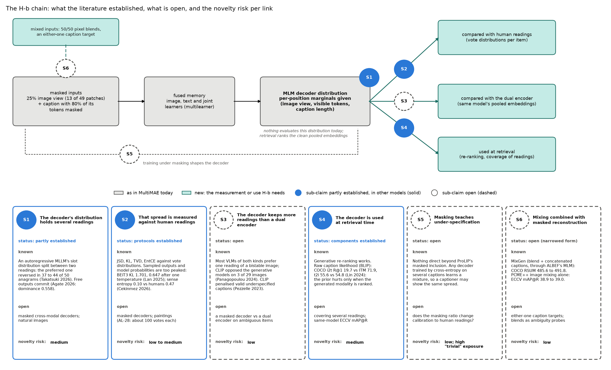
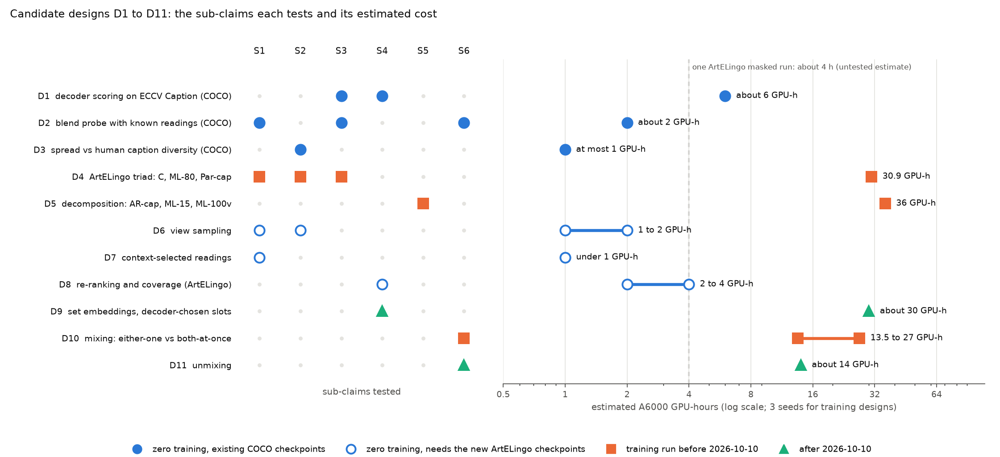

# No source we found has tested a masked cross-modal decoder as a model of several readings, and a captioner is the baseline it must beat: an integrative review of H-b

Date: 2026-10-06. Branch `ml-improve-stages-1-2`. Previous reports: [Stages 1 and 2 of the masking line](../auto/v1/2026-10-06_masking_stages_1_2.md), and the [lever review](2026-10-03_lever_review.md) of 2026-10-03, which this review extends without repeating. Figures are built by [`build_2026-10-06_masked_decoder_readings_review.py`](../assets/build_2026-10-06_masked_decoder_readings_review.py); the brief, bibliographies, verification records and synthesis behind the review are in [`assets/2026-10-06_masked_decoder_readings_review/`](../assets/2026-10-06_masked_decoder_readings_review/).

## Summary

On COCO, fine-tuning CLIP B/32 with 80% text masking raised ECCV Caption mAP@R to 37.94, against 37.11 for the contrastive baseline. The gain sat in the image tower and showed no sign of polysemy. Those results test the retrieval embedding (H-a). They do not test the masked decoder, where H-b places the several readings. Before training anything for H-b we ran an integrative review on six themes, had three separate agents re-check the load-bearing numbers against the papers, and synthesised the result.

1. Partly established (moderate evidence), in other models: a decoder's distribution at one slot can split between two readings and follow context. In LLaVA-family models the preferred reading of a Visual Anagram reversed with rotation for 37 to 44 of 50 anagrams (Takatsuki et al. 2026). Free reports mostly committed to one reading: about 10% of beam mass named both animals near the ambiguity boundary, against at least 98% for two-animal controls. LLaVA-1.6's sampled captions of bistable images had a mean dominance of 0.558 (Agate 2026).
2. Established: how to compare a model's spread with human votes, by JSD, KL, TVD and EntCE against per-item vote distributions. Moderate evidence: the direction of the answer for sampled outputs and model probabilities, where every such comparison we found had models more peaked than people. BEiT3's VQA answer distribution sat at KL 1.701 against the annotators' answers, and one global temperature brought it to 0.647 (Lan et al. 2025). Image generators' sense entropy was 0.10, against 0.47 for people (Cekinmez et al. 2026). The exception is a verbalized estimate: asked to predict the human distribution, LLMs gave flatter ones than people (0.73 against 0.47; Cekinmez et al. 2026).
3. Established: generative scores work as re-rankers, and need a prior correction only when they rank the modality they generate. BLIP's raw caption likelihood gave COCO 5k image-to-text R@1 19.7, against 71.9 for its own matching head (48.0 after a tuned correction). Text-to-image it gave 55.6 against 54.8 (Lin et al. 2024).
4. Verification changed four readings. MixGen's ablation cannot show that the concatenated caption matters: a variant that kept a random half of its tokens, and also drew λ from Beta(0.1, 0.1), kept almost all of the gain (COCO RSUM 477.1 against 477.7 for MixGen and 470.7 for the baseline, one run per cell). Both-at-once reports do occur (43 to 51% of beam mass on one figure-ground stimulus, in three of five LLaVA models). ArtECulture's agreement figures come from an agreement-filtered subset. ArtELingo-28 has about 100 votes per painting, not 140.
5. Open, within N's search queries (Q1 to Q40) and V3's three extra searches: no source compares a masked cross-modal decoder's distribution with human readings, compares it with a dual encoder on ambiguous or multi-reading items, or uses it at retrieval to cover several readings. Masked likelihood has been used for retrieval and compositional matching (UniDisc, Masked Diffusion Captioning), but neither study measured readings. No found work trains with pixel blends and an either-one caption target under masked reconstruction, or uses blends as ambiguity probes.
6. Novelty risk, in our view: medium-low overall (S1 medium, S2 low to medium, S3 low, S4 medium, S5 low, S6 low). The risk sits in one reviewer question: what does masking add over a captioner's next-token probabilities? Two readouts favour masking by construction: averaging over masked image views, which a masked model trains on, and readings selected by an arbitrary subset of caption tokens. Prefix selection is also open to an autoregressive captioner.
7. Proposed first steps, for the author to decide on: a zero-training COCO probe suite (about 8 GPU-hours), then an ArtELingo triad of a contrastive model, ML-80 and a parallel captioner, scored against held-out ArtELingo-28 votes (30.9 GPU-hours), then the two masking-specific readouts (about 3 GPU-hours). The whole sequence in section 7 costs about 126 to 155 of about 400 free GPU-hours, so the binding constraints are code and review time.

Where the synthesis or a verifier disagreed with the papers' raw text, the report follows the raw text; section 2.3 lists the six such points, four of them found by the final review.

**Terms.** A **reading** is one valid interpretation of an image or caption. **Polysemy** here means that one item supports several readings, not only that a word has several senses. **H-a** is the claim that cross-modal masked reconstruction makes the ordinary retrieval embeddings (CLIP's pooled vectors) keep more readings. **H-b** is the claim that the masked model itself, through its decoder's predictive distribution over masked tokens, represents several readings that a contrastive **dual encoder** (one pooled vector per item, ranked by cosine similarity) cannot, and that this can be measured and used for retrieval. **S1 to S6** are H-b's sub-claims (section 1.6) and **D1 to D11** the candidate designs (section 6). The **MLM decoder** is MultiMAE's masked-language-model head: learned per-position queries read a fused memory built from 13 of the 49 image patches of CLIP B/32 ("the 25% view") and the masked caption, and predict every caption position in parallel. It therefore returns per-position marginals given (image view, visible tokens, caption length). **ML-15** and **ML-80** are `fusion_multilearner` at 15% and 80% text masking, **C** the contrastive-only model, **Par-cap** a plain parallel captioner (full clean image, 100% text masking, no partial caption), **AR-cap** an autoregressive captioner, and **ML-100v** a 25% image view with 100% text masking. **AL-28** is ArtELingo-28, WikiArt paintings annotated in 28 languages. **JSD**, **KL** and **TVD** are the Jensen-Shannon distance, the divergence KL(human ‖ model) and the total variation distance between a model's and the annotators' label distributions; **EntCE** is the per-item gap between model and human entropy, **RankCS** the agreement of the model's class ranking with the vote ranking, and the **split-half ceiling** the agreement between two random halves of the annotators. **LDL**, label distribution learning, predicts each item's vote distribution. A **PMI score** divides a likelihood by a prior likelihood (here, the caption's likelihood under a content-free image). **PLL**, pseudo-log-likelihood, sums each token's log-probability when that token is masked. **Coverage@k** is the share of a painting's distinct readings that have at least one of its own captions in the top k. **ECCV mAP@R** is average precision over the top R ranks, R being the number of human-verified positives in ECCV Caption's re-annotation of COCO 5k test. **VWSD** is visual word sense disambiguation (SemEval-2023 Task 1), scored by Hit@1. **RSUM** is the sum of the six recalls R@1, R@5 and R@10 in both retrieval directions. **MRR** is the mean reciprocal rank of the correct item. **AUROC** is the area under the ROC curve (the VSE paper calls it AUC). **CIDEr-D** scores a caption's agreement with the reference captions; its oracle version takes the best of M generated captions. **ARO** is a benchmark of text-only adversarial negatives, true captions against perturbed ones, with VG-Relation, VG-Attribution, COCO-Order and Flickr-Order sets. **Evidence strength** is strong (several sources or repeated runs, verified), moderate (one strong source or several weaker ones), weak (single runs, workshop papers, distant settings) or none. **[reader-inferred]** marks the synthesis's own judgment, **(computed)** its arithmetic, and **(digest-level)** a number read only through a page summary and never re-read from the paper.

## 1. The question

### 1.1 The goal and the two claims

The author's broad goal, set on 2026-10-03 and restated on 2026-10-06, is to "enable a more polysemic way of understanding through cross-modal masked reconstructions". We split it into H-a (the encoder keeps more readings) and H-b (the decoder's distribution holds them). Our COCO evidence leans weakly against H-a (section 1.3). This review is about H-b.

### 1.2 Why masking might help

A heavily masked input is under-specified. A quarter of a painting fits many captions, and a fifth of a caption fits many images. A reconstruction loss on such inputs has to spread its probability over the valid completions. InfoNCE, the in-batch contrastive loss, uses one positive per item, so it pulls each item toward one point and treats the other valid captions as negatives. The questions are whether the spread a masked decoder learns tracks human readings, and whether masking adds anything to what any captioner learns.

### 1.3 What the COCO line showed

MultiMAE fine-tunes OpenAI CLIP ViT-B/32 (both towers) on COCO Karpathy train for 10 epochs at batch 128. Retrieval uses only CLIP's clean pooled embeddings. A masked pass drops 75% of the image patches before the ViT and replaces a share of caption tokens with a learned mask token. The visible tokens go through the multilearner fusion (image, text and joint transformer learners), and two query decoders reconstruct the masked pixels (MAE) and predict the masked tokens (MLM).

*Table 1. ECCV Caption mAP@R on COCO 5k test (Stages 1 and 2 report).*

| Model | Seeds | mAP@R |
|---|---|---|
| C (contrastive only) | 3 | 37.11 |
| ML-15 | 3 | 37.24 |
| ML-80 | 5 | 37.94 (passes the pre-registered test) |

The gain sat in the image tower and needed the MLM to read the masked-pass image tokens: controls at 80% without fusion or with a clean image lost it. It showed no polysemy signature. VWSD Hit@1 was 52.92, +0.36 over ML-15 (p = 0.760). The image-to-text gain over ML-15 shrank from +0.85 to +0.19 from the lowest to the highest tertile of the number of valid matches per query. At 80% the MLM is close to parallel captioning from 25% of the patches: its loss per masked token rose from 1.569 nats (ML-15) to 3.053 (ML-80), perplexity 4.8 to 21.2. Nothing has yet evaluated the decoder itself. One run costs about 7 A6000-hours on COCO and an estimated 4 on ArtELingo.

### 1.4 The mixing idea

The author also asked about mixing: blend two images at 50% opacity, attach captions and reconstruct (MixGen-like). There are two framings. A concatenated caption teaches "both at once", one reading that names A and B. Keeping each source caption as a separate valid target teaches "either one", two alternative readings, which is closer to polysemy; under masked reconstruction the visible part of a caption could select which reading to rebuild. Blends also give synthetic ambiguous images whose readings are known exactly.

### 1.5 Testbeds

ArtELingo (WikiArt paintings) is the planned main testbed. Each annotator gives one of 9 emotion labels and a free-text explanation. The English part has 308,723 captions on 61,402 training paintings; validation has 15,531 captions on 3,119 paintings. The retrieval test split holds 4,975 paintings with at least 5 captions each. Counted over all of a painting's test captions (5 to 12), 86 of them have one distinct emotion, 687 two, 1,718 three, 1,840 four and 644 five or more. Captions have a median of 14 words. AL-28 gives dense votes: our local CSV has 1,658 paintings with a median of 108 votes each, over 10 labels including "other". 1,160 of those paintings are in ArtELingo train.

COCO with ECCV Caption is the development bed: 5 captions per image plus ECCV Caption's human-verified extra positives. Its multiplicity is mostly paraphrase-level.

The author's other project, CoSiR, uses ArtELingo for conditional image-text similarity (emotion or style as the condition), with PercepT (Mohamed et al. 2026) as a baseline. This line stays distinct: emotion is only ever read out of the model, never supplied as a retrieval condition.

### 1.6 Sub-claims

*Table 2. H-b split into sub-claims (from the novelty sweep N).*

| ID | Sub-claim |
|---|---|
| S1 | A masked or generative cross-modal model's predictive distribution represents several readings (bimodal or high-entropy predictions on ambiguous inputs). |
| S2 | That spread is measured against human readings in image-text settings. |
| S3 | Masked or generative models are compared with contrastive dual encoders on ambiguity or polysemy. |
| S4 | The decoder or its distribution is used at retrieval time to cover several readings. |
| S5 | Masking teaches under-specification or ambiguity, beyond ProLIP's masked inclusion. |
| S6 | Mixing or synthetic ambiguous images are combined with masked reconstruction for polysemy. |

*Sources: the review brief (`00_brief.md`); the [Stages 1 and 2 report](../auto/v1/2026-10-06_masking_stages_1_2.md), Summary and Table 7; N, sub-claim list; synthesis sections 1.2 and 5.1 for the ArtELingo counts (the lead agent's local counts).*

## 2. Method

### 2.1 Search

We used an integrative review (ARS deep-research, lit-review mode), the form the author chose for the 2026-10-03 review: a structured search and a critical synthesis across study designs, without meta-analysis. Six agents searched on 2026-10-06 under one brief. The rules were to read every number from the paper with a locator, never fill in a number, venue or arXiv id, mark anything unconfirmed, search actively for 2024 to 2026 work, and extend the 2026-10-03 bibliographies rather than repeat them.

*Table 3. Search per theme (counts as each bibliography reports them; "about" marks approximate counts).*

| Theme | Queries | Identified | Screened | Full text | Included |
|---|---|---|---|---|---|
| G1 scoring image-text matches with a generative model | 20 | about 75 | about 30 | 20 | 13 |
| G2 model distributions against human disagreement | 19 | about 70 | about 40 | 24 | 16 |
| G3 subjective and affective image-text data | 15 | about 45 | about 25 | 13 (summary level) | 13 |
| G4 several readings from one model (generation or representation) | 16 | about 45 | about 28 | 19 | 17 |
| G5 cross-modal mixing augmentation | 14 | about 45 | about 30 | 14 | 14 (2 abstract only) |
| N novelty sweep across S1 to S6 | 44 | about 390 links | about 95 | 13, plus 7 abstracts | 16 (10 core, 6 short) |

Several agents read pages through a fetch tool that returns a small model's summary. G2, G3 and N re-read their load-bearing tables from the raw HTML; the verifiers read raw HTML or LaTeX throughout.

### 2.2 Verification

Three agents re-read each load-bearing claim at its locator, in the raw arXiv HTML (V1, V3) or the LaTeX source (V2). They checked metadata against the arXiv API, Semantic Scholar, Crossref, the ACL Anthology and venue pages. Their corrections override the bibliographies throughout.

*Table 4. Verification outcomes in claim rows (a row can bundle several numbers). Counts are our recount of each verifier's claim-row table.*

| Pass | Covers | Sources | Existence | Rows | Confirmed | Corrected | Locator wrong | Not found | Not re-read | Other |
|---|---|---|---|---|---|---|---|---|---|---|
| V1 | G1, G2, G3 | 41 | 41 verified | 91 | 68 | 14 | 1 | 3 | 3 | 1 plausible (counted as a fail), 1 added fact |
| V2 | G4, G5 | 34 | 32 verified, 1 plausible (M3ixup), 1 without an outcome in V2's table | 79 | 54 | 13 | 0 | 0 | 12 | |
| V3 | N | 16 | 14 verified, 1 plausible, 1 unverifiable (AmbiBench paper) | 33 | 26 | 6 | 0 | 1 | 0 | |

No verifier found a fabricated source or number. M3ixup is plausible only because its publisher page was blocked and only the abstract was read. V3's summary names UniDisc as its plausible source, while its source table marks UniDisc verified (arXiv, no venue found) and only the AmbiBench dataset plausible. The AmbiBench paper sits behind an OpenReview challenge page, and only its dataset card could be read. V1's own summary agrees with its rows. V2's summary (G4: 28 confirmed, 11 corrected, 2 not re-checked; G5: 25, 11, 1 locator wrong, 1 not found, 8 not re-checked) and V3's (21, 9, 1 not found, 2 not re-checked) do not match their own row tables, so Table 4 uses the rows.

### 2.3 Corrections that changed conclusions

From the verifiers:
- MixGen (V2 problem 8): its ablation does not support "the concatenated caption matters" (section 3.6).
- Raw generative likelihood (V1 problem 7) fails only for image-to-text; text-to-image it is on par with the matching head (section 3.4).
- Takatsuki et al. (V3 problem 2): reports naming both readings exist, on the Raven-Bear stimulus.
- ArtECulture (V1 problem 1): its agreement figures come from images kept only when all three cultures had a majority.
- ArtELingo-28 (V1 problem 2): about 100 votes per painting; the paper's "about 140" contradicts its own totals.
- MASS and DiffusionITM (V1 problems 5, 6): their retrieval numbers are re-rankings of CLIP's top 20 and of 10 candidates.
- Absence claims: G5's broad claim failed (M3ixup mixes visual features and sentence embeddings, and an IBM patent interpolates images and captions, for captioning); the narrowed form held (V2 section 4). G2's claim narrowed to sampled meaning clusters on still images (V1, claim G2-1).
- Venues: Lan et al. is AAAI 2025 (N had "preprint"); Masked Diffusion Captioning is Findings of EMNLP 2025; Panagopoulou et al., Agate and Cekinmez et al. are workshop papers; Visual Semantic Entropy and Takatsuki et al. are accepted at ECCV 2026 and EMNLP 2026 by the authors' statements; MixReorg is ICCV 2023, Mix-up SSL ICME 2022, M3ixup Pattern Recognition 158 (2025) and MixCo a NeurIPS 2020 workshop paper.

Made here or by the final review, where the synthesis or a verifier disagreed with the papers' raw text:
- sMCL against beam search. The synthesis, following V2's prose, says winner-take-all training beat beam search only at M ≤ 3 hypotheses. V2's own rows give sMCL oracle CIDEr-D 0.822, 0.862, 0.911 and 0.922 for M = 2 to 5, against 0.754, 0.833, 0.888 and 0.943 for beam search over one model. sMCL led up to M = 4, and beam search led only at M = 5.
- Cekinmez et al.'s locator. The synthesis and V3 cite Table 1 for the sense entropies, but that paper's Table 1 is its cross-lingual table. We grepped V3's saved copy: 0.10 and 0.25 are in Sec 4.1 and Fig 2, the human 0.47 in Fig 2 and Table 2 (0.473), and the models' predicted 0.73 in Table 2 (0.730). The verifier of the 2026-10-03 review had found the same.
- Panagopoulou et al. (final review). V3 reported N's "almost opposite preferences" statement as not found. It is in Sec 4.1, scoped to the three images with the highest cross-model variation (Woman-Trumpeter, Schroeder Stairs, Raven-Bear); V3 found only a second statement, about BLIP-2 OPT against its Flan-T5 variants. Sec 4.2 names the CLIP variants as the "primary exception" sensitive to brightness and tint, and the 12 models are three CLIP variants and nine generative VLMs. V3 rows 18 to 20 and problem 1 are overruled.
- UniDisc (final review). V3 row 24 read only the DataComp column of Fig 7. UniDisc's clear advantage on DataComp is joint retrieval, and its single-direction results tie there; on CLEVR-Ret and Winoground the single-direction results favour UniDisc.
- ChaosNLI (final review). V1 problem 4 grouped αNLI with MNLI as at or worse than chance. On αNLI six of nine models beat chance on JSD while every model's KL is 2 to 9 times chance; MNLI is at or worse than chance on both measures.
- MixGen variant (e) (final review). It kept half the concatenated tokens and also drew λ from Beta(0.1, 0.1), so it differs from MixGen in two ways. The conclusion that the ablation cannot show the concatenated caption matters stands.

### 2.4 Synthesis

A synthesis agent integrated G1 to G5 and N as corrected by V1 to V3, with the brief, the Stages 1 and 2 report, its own reading of `mmae/models/{model,decoders,masking,fusion}.py` (marked [code] in the synthesis) and facts the lead agent checked locally (ArtELingo split counts, the AL-28 CSV and compute). It did not re-read sources. Its costs, kill thresholds and sequence are proposals.

Supporting files, each with one added header line: the [brief](../assets/2026-10-06_masked_decoder_readings_review/00_brief.md); bibliographies [G1](../assets/2026-10-06_masked_decoder_readings_review/G1_generative_scoring.md), [G2](../assets/2026-10-06_masked_decoder_readings_review/G2_human_disagreement.md), [G3](../assets/2026-10-06_masked_decoder_readings_review/G3_affective_image_text.md), [G4](../assets/2026-10-06_masked_decoder_readings_review/G4_multiple_readings.md), [G5](../assets/2026-10-06_masked_decoder_readings_review/G5_crossmodal_mixing.md), [N](../assets/2026-10-06_masked_decoder_readings_review/N_novelty_hb.md); verification [V1](../assets/2026-10-06_masked_decoder_readings_review/V1_verification_G1_G3.md), [V2](../assets/2026-10-06_masked_decoder_readings_review/V2_verification_G4_G5.md), [V3](../assets/2026-10-06_masked_decoder_readings_review/V3_verification_N.md); [synthesis](../assets/2026-10-06_masked_decoder_readings_review/S_synthesis.md).

*Sources: the brief; G1 to G5 and N, section 1 of each; V1 to V3, sections 1 and 3; synthesis header and sections 1, 3 and 9.*

## 3. Findings by sub-claim

Figure 1 places the six sub-claims on the chain that H-b needs. The masked pass, the fusion and the MLM decoder exist in MultiMAE today. Everything after the decoder is new: comparing its distribution with human readings, comparing it with the same model's dual encoder, and using it at retrieval.

*Figure 1. The H-b chain. Grey boxes: as in MultiMAE today. Teal boxes: the measurement or use H-b needs. Filled blue markers and solid cards: sub-claims partly established, in other models; dashed markers and cards: open. Each card lists what the literature established, what is open, and the review's novelty-risk judgment.*

### 3.1 S1: the decoder's distribution holds several readings

*Baseline: the control stimuli each paper ran (unambiguous or two-object images). No study of natural images exists to supply one.*

Converging evidence came from autoregressive multimodal LLMs on illusions. Takatsuki et al. (2026) read LLaVA-family next-token probabilities after the prefix "I see a" on 50 synthetic duck-rabbit-like Visual Anagrams. The preferred reading reversed at some rotation for 37 to 44 of the 50, depending on the model, along a logistic psychometric curve (Sec 3.2.1, App. A.2.1). Textual cues shifted the balance but could not induce an absent animal on unambiguous controls (Sec 3.2.2). One slot's distribution thus held two competing readings, and its balance followed visual and textual context.

Free reports mostly committed to one reading. With LLaVA-1.5-7B, 8 beams and an LLM judge, about 10% of beam mass named both animals near the ambiguity boundary, against at least 98% for two-animal controls (Sec 3.3, Fig 5). Models answered "1 object" with p = 0.88 to 0.99 (Table 2). The exception V3 added: on the Raven-Bear figure-ground stimulus, three of five LLaVA models put 43 to 51% of beam mass on continuations naming both readings (App. B.4.1).

Agate (2026) found both readings' sparse-autoencoder features active in CLIP ViT-L layer-22 patch activations for 50 of 69 bistable stimuli (Sec 4.3). The split was uneven by group: 12 of 12 duck-rabbit, 7 of 16 face-vase, 1 of 4 Schroeder stairs. LLaVA-1.6's sampled captions mostly committed (mean dominance |P(A) − P(B)| = 0.558 over 83 stimuli; on 10 they named neither aspect; Sec 4.1). Panagopoulou et al. (2024) scored 12 VLMs on 29 bistable images in 3,364 manipulated versions; most preferred one interpretation and named a single one in free captions (Sec 4.7).

The readout mattered. Visual Semantic Entropy (Huy et al. 2026) argued that sample entropy under-reports ambiguity when the visual representation is confident, and that perturbing the image helps. Its gain over the strongest baseline per model was +0.009 to +0.073 AUROC on A-OKVQA (Table 2). The "visual confidence" account was tested with a LogitLens proxy on misanswered adversarial items, without human ambiguity labels. Generators were far more peaked than people over word senses: normalised sense entropy was 0.10 for image models and 0.25 for text models, against 0.47 for humans (Cekinmez et al. 2026, Sec 4.1, Fig 2, Table 2). Asked to predict the human distribution, the text models gave a flatter one than people, about 0.73 (Table 2).

Caption diversity numbers can mislead: DiffCap's inter-distinct bigrams were 77.33%, against BLIP's 14.75%, but BLIP decoded deterministically, so the gap measured determinism (He et al. 2023). Masked and discrete-diffusion captioners worked as captioners (DDCap CIDEr 117.8, against 112.8 for an autoregressive model), and neither DDCap nor Masked Diffusion Captioning reported sample diversity.

Our own decoder is a CapPa-style parallel predictor [reader-inferred]: CapPa fed all-[MASK] decoder inputs and dropped the causal mask (Tschannen et al. 2023). It returns per-position marginals, not a joint distribution. A slot that carries the reading, such as an emotion word or the identity of a blended source, gives the forced-choice readout that Agate and Takatsuki found more revealing than free sampling. A whole reading needs iterative unmasking, because independent marginals can mix two readings across positions; DDCap's repeated words are a symptom of the same parallel decoding. At 80% masking the decoder already trains in the under-specified regime (MLM loss 3.053 nats against 1.569 for ML-15), so a spread is expected there.

Evidence strength: moderate that an autoregressive MLLM's slot distribution can split between two readings on illusion stimuli (two 2026 papers, one model family, one stimulus class); weak for natural images; none for masked cross-modal decoders, not found in N's queries Q1, Q11, Q17, Q29, Q33 and Q37 or in V3's three extra searches. Novelty risk: medium.

*Sources: Takatsuki et al. Sec 3.2.1, 3.2.2, 3.3, App. A.2.1, Fig 5, Table 2, App. B.4.1; Agate Sec 4.1, 4.3; Panagopoulou et al. Sec 4.7; Huy et al. Table 2; Cekinmez et al. Sec 4.1, Fig 2, Table 2; DiffCap diversity table; DDCap; MDC; CapPa pretraining section. V3 rows 1 to 17; V2 G4 rows 13, 20, 21, 26; final review MINOR 4.*

### 3.2 S2: that spread is measured against human readings

*Baselines: uniform chance, the estimated human agreement, and the same model before temperature calibration.*

The protocols converged.
- ChaosNLI (Nie et al. 2020) collected 100 labels per NLI item. On SNLI, models reached JSD about 0.23 (BERT-base 0.2345, RoBERTa-base 0.2294), against 0.383 for uniform chance and 0.0614 for humans, while their KL of 0.47 to 0.53 sat near chance (0.5457). On αNLI every model's KL was 2 to 9 times chance (0.83 to 3.80 against 0.406) while six of nine models beat chance on JSD; on MNLI both measures were at or worse than chance (JSD 0.3055 to 0.3165 against 0.3023; KL 0.6652 to 0.8845 against 0.3559; Table 5).
- Baan et al. (2022) showed that ECE punishes a perfect oracle: 0.25, against RoBERTa's 0.14. They proposed instance-level measures, EntCE, RankCS and DistCE (a TVD). Temperature scaling cut ECE from 0.14 to 0.03 while DistCE moved only from 0.26 to 0.22 (Table 1).
- Lan et al. (2025) carried this to VQA. BEiT3's answer distribution sat at TVD 0.436, KL 1.701 and EntCE 0.541 against 10 annotators (Table 1). One global temperature fitted to the human distributions (t = 2.0) brought KL to 0.647; scaling for accuracy instead raised it to 3.232 (Table 2). Fit was best on the most uncertain third of items: KL 2.150 in the least uncertain third, 1.408 in the most (Table 1).
- MultiEmo-Bench (Chen et al. 2026) gave an image-emotion ceiling: human split-half PLCC 0.700, against 0.634 for GPT-4o (Table 4; 0.716 in Sec 3 under a different protocol). Its halves hold about 10 votes each, so the ceiling understates a full 20-vote human.
- Wang and Chan (2019) validated set-level caption diversity against human diversity judgements at about 0.6 (Self-CIDEr, overall Spearman 0.617).

For sampled outputs and model probabilities the direction was negative: every such comparison found models too peaked (Lan et al.; Cekinmez et al.'s 0.10 against 0.47) or no better than chance on some divergence measures (Nie et al.). The exception is a verbalized estimate. Asked to predict the human sense distribution, LLMs gave flatter ones than people (0.73 against 0.47; Cekinmez et al. Table 2), with 0.55 of the mass on the dominant sense against 0.72 for humans (App. F). CNNs did not show human-like uncertainty without soft labels (Peterson et al. 2019, digest-level). Uma et al. (2021) concluded that soft-label training helps when many high-quality judgements per item exist (conclusion only).

On art, agreement was low and the dense set is small. ArtEmis (Achlioptas et al. 2021) found a strong majority emotion for only 45.6% of paintings, and at least one positive and one negative emotion for 61%, with at least 5 annotators per painting (Sec 3.2). ArtECulture (Chen et al. 2026) reported α of 0.306 to 0.324 and majority shares of 70 to 76%, but only on images kept because each of three cultures had a majority, so these overstate ArtELingo-wide agreement. Even there, cross-culture Fleiss κ was 0.088. AL-28 (Mohamed et al. 2024) states about 140 votes per image, but its own totals give 100 (200K on 2,000), and our local CSV has 173,745 rows on 1,658 paintings, median 108.

The absence narrowed. We found no paper (V1's three queries) that compares a captioner's sampled meaning clusters or distribution with human caption or emotion distributions on still images or paintings. Wang and Chan compared scalar set diversity on COCO. VEGAS (2026, video) found that Gemini captions "cover only a small portion of the semantic variation among human annotations". Yao et al. (2026) found 3.61 to 4.44 verb-sense clusters per imSitu image (N's raw read, not re-checked), a reminder that single-gold scoring under-counts readings.

ArtELingo's own five votes are too few for distribution-level tests (computed; [reader-inferred]). Five draws from a uniform distribution over the 9 labels give 4.0 distinct labels on average. A painting with one emotion at 50% and the rest spread evenly still gives 3.2. Over the five retrieval captions the mean is 3.37 distinct emotions per painting, between the 3.2 of a 50%-dominant painting and the 4.0 of a uniform one. The distinct-emotion count therefore cannot separate a spread of readings from sampling noise, and distribution-level claims need the dense AL-28 votes.

Evidence strength: strong for the protocols; moderate for "sampled outputs and model probabilities are too peaked" (four settings, none of them a masked decoder, and one verbalized estimate that went the other way); none for masked decoders on art. Novelty risk: low to medium.

*Sources: Nie et al. Table 5; Baan et al. Table 1; Lan et al. Tables 1, 2; MultiEmo-Bench Table 4, Sec 3; Wang and Chan; ArtEmis Sec 3.2; ArtECulture agreement analysis; AL-28 abstract, Sec 1, Table 1; VEGAS Sec 4; Cekinmez et al. Sec 4.1, Table 2, App. F. V1 rows 32 to 52, 59, 79 to 81, problems 1, 2, 4 and claim G2-1; V2 G4 row 19; V3 row 17; final review M4 and MINOR 1, 5.*

### 3.3 S3: generative or masked models against contrastive dual encoders

*Baseline: the dual encoder's own similarity profile over the candidate readings.*

The one head-to-head on multi-reading images found a qualitative difference between contrastive and generative models on a few images. Panagopoulou et al. scored three CLIP variants by similarity and nine generative VLMs by label likelihood. Most models of both kinds preferred one reading. On the three images with the highest cross-model variation (Woman-Trumpeter, Schroeder Stairs, Raven-Bear), the CLIP variants showed "almost consistently opposite preferences to the LLM based generative models" (Sec 4.1). Brightness and tint had minimal effects except on CLIP, the "primary exception" (Sec 4.2), and CLIP also varied most under rotation. The comparison is qualitative, on 29 images, with no human-distribution metric. Pezzelle (2023) found that CLIPScore fell about 16 points when a caption's subject became "they" and about 40 points for a fully underspecified caption. For 82 of 100 images at least one unrelated caption outscored the valid underspecified one (Sec 3; one annotator, "for illustrative purposes"). There was no generative arm.

Generative scoring won on adversarial text, mostly through a language prior.
- Lin et al. (2024) scored BLIP by caption likelihood. On ARO it beat the contrastive (ITC) and matching (ITM) heads: VG-Relation 89.1, against 63.1 and 58.7 (Table 1).
- Much of that win was a language prior. BLIP's decoder fed noise images already reached 87.6 on VG-Relation, and text-only language models reached 95.0 to 98.6 on the two order sets. The CapPa paper's blind autoregressive decoder (Cap with zeroed image features) reached 83.7 on VG-Attribution and 86.2 on VG-Relation.
- Masked Diffusion Captioning (Feng et al. 2025) beat CLIP on seven compositional columns (77.9 to 98.8, against 27.2 to 72.8), but its autoregressive twin scored about the same (76.0 to 98.4). The advantage belongs to generative scoring, not to masking.
- MASS's per-token PMI depended on the backbone. It beat ITM with OFA (Winoground group 9.5 to 20.3) and barely with BLIP-2 (15.5 against 18.0; Table 3).

Mechanisms on the contrastive side point both ways. CLIP's text encoder favoured the first-mentioned object and its image encoder the largest object (Abbasi et al. 2025, abstract only), one route by which a pooled point keeps a dominant reading. Agate, on the other hand, found both readings in a contrastive tower's patch features.

Our own COCO evidence concerns H-a. The ML-80 gain sits in the image tower, did not change VWSD and did not grow with the number of valid matches (section 1.3). Nothing has yet compared our decoder with our dual encoder.

A fair test compares distributions with distributions [reader-inferred]. "One point per item" does not mean one reading: a dual encoder's similarity profile over candidate readings, such as a softmax over prompts, is also a distribution. Geometry limits it only when valid readings lie far apart in the embedding space, which is the PVSE and PCME argument covered by the 2026-10-03 review. The contrastive model's prompt softmax and a soft-label probe on its embedding are therefore the baselines.

Evidence strength: weak; the sub-claim is open. Novelty risk: low.

*Sources: Panagopoulou et al. Sec 3.2, 4.1, 4.2; Pezzelle Sec 3; Lin et al. Table 1; CapPa ARO table and its blind-decoder note; MDC compositionality table; MASS Table 3; Abbasi et al. abstract. V1 rows 4, 5, 13, 14, 29; V2 G4 row 23; V3 rows 21, 22; final review M1 (overruling V3 rows 18 to 20 and problem 1) and NIT 1.*

### 3.4 S4: the decoder or its distribution used at retrieval time

*Baselines: the dual encoder's ranking and, for a generative scorer, the same model's matching head.*

Generative scoring costs more than a dual encoder, and its published retrieval numbers are re-rankings. Lin et al.'s caption likelihood costs one decoder pass per pair, as ITM does. MASS doubles that for its prior: 0.55 s against 0.27 s per sample (App. D). A diffusion score took 68 minutes, against about 4 for OpenCLIP, on Flickr30K text-retrieval validation, and its authors called such models "slow retrievers applied to a small set of candidates" (Krojer et al. 2023).

MASS re-ranked CLIP's top 20. DiffusionITM's Flickr task re-ranked 10 candidates: the naive classifier scored 11.1 (chance is 10%), the corrected score 61.5 and CLIP RN50x64 71.9 (Table 1a). UniDisc (Swerdlow et al. 2025), a masked joint image-text diffusion model, retrieved by likelihood among 16 random candidates. On DataComp it beat the autoregressive baseline only in joint retrieval (0.64 against 0.17) and tied in single-direction retrieval (0.85 against 0.85; 0.95 against 0.96). On CLEVR-Ret it also led in text and image retrieval (0.94 against 0.81; 0.25 against 0.06), and on Winoground in text retrieval (0.31 against 0.24). There was no contrastive baseline (Fig 7).

For masked models, Salazar et al. (2020) masked each token in turn, one pass per token, and noted that a masked model can be fine-tuned to score in a single pass. Kauf and Ivanova (2023) showed that the original PLL inflates multi-token words; masking a word's later subtokens as well raised BLiMP accuracy by 0.2 to 1.3 points (Table 1). Holtzman et al. (2021, digest-level) found a prior-corrected score failing on HellaSwag, ARC-Easy and BoolQ, which G1 read as the correction hurting when the prior is informative.

Sampling raised retrieval scores but merged the readings. IC3 (Chan et al. 2023) sampled 10 captions and summarised them with GPT-3 into one caption. CLIP text-to-image MRR on COCO rose from 0.501 to 0.734 for BLIP (Table 5), and noun recall against all references from 0.266 to 0.353 (Table 7; N's raw read). Candidate-set diversity correlated with MRR at only r = 0.059 to 0.094 (App. C.5; N's raw read). IC3's Flickr claim of "up to 84.46%" does not match its Table 6 (+47.5%).

For several outputs per input, winner-take-all training made ensemble members specialise. sMCL (Lee et al. 2016) led beam search over one model up to M = 4 hypotheses (oracle CIDEr-D 0.911 against 0.888 at M = 4), and beam search led at M = 5 (0.943 against 0.922). Set embeddings collapse without help: MaxMatch (Alomari et al. 2025) raised rSum over SetDiv from 442.6 to 469.9 on Flickr30k with ResNet + Bi-GRU, and from 514.8 to 520.8 with Faster R-CNN + BERT. The known fixes are soft winners (Rupprecht et al. 2017: ε = 0.05; oracle LSP accuracy 59.7 with one hypothesis, 62.8 with 10), learned winner scores (Resilient MCL: best EMD, slightly worse oracle error) and annealing (Annealed MCL matched permutation-invariant training on WSJ0-mix, 16.85 against 16.88). AMER generated several query vectors for text retrieval (abstract only).

Both absences held within their searches. We found no ECCV mAP@R, CxC or other multi-positive metric for a generative likelihood against a contrastive score from the same model (V1's two queries, claim G1-1). IG Captioner (Yang et al. 2024) compares a captioner's likelihood with CLIP on COCO and Flickr, without a multi-positive metric, and was not read in full. We found no retrieval method that lets a reconstruction or generative loss choose which embedding slot a target belongs to (V2's three queries and G4's Q4, Q14 to Q16).

Costs for our decoder differ [reader-inferred, from the code]. At a training-like mask, scoring costs one pass per (pair, mask). At 100% text masking the logits depend only on (image view, caption length), so one pass per (image, view, length) scores every caption of that length by indexing, and full-gallery scoring in both directions costs a few dozen gallery encodings. By Lin et al.'s and DiffusionITM's results the prior term matters only when ranking the generated modality, which for our MLM is image-to-text.

Evidence strength: moderate for re-ranking feasibility and prior correction; weak that decoder scores improve one-to-many metrics; none for per-reading sets from a masked decoder. Novelty risk: medium.

*Sources: Lin et al. Sec 3, Table 3; MASS Sec 4.3, App. D; Krojer et al. Table 1a and runtime paragraph; UniDisc Fig 7; Salazar et al. abstract; Kauf and Ivanova Table 1; IC3 Tables 5 to 7, App. C.5; sMCL captioning table; MaxMatch tables; Rupprecht et al. results; Resilient and Annealed MCL. V1 rows 1, 8, 9, 16, 19 to 26 and problems 5 to 7; V2 G4 rows 8, 9, 27 to 35; V3 rows 23 and 25 to 28; final review M3 (overruling V3 row 24).*

### 3.5 S5: masking teaches under-specification

*Baseline: a captioner trained on the same data, which sees no masked image views.*

We found no direct evidence. ProLIP's masked inclusion (covered by the 2026-10-03 review) remained the only training-side use of masked inputs as under-specified views. Pezzelle and FOCUS (Zhou et al. 2025, abstract only) found that dual encoders and VLMs mishandle underspecified text. D-MLM (Gowda et al. 2025) predicted Gaussian parameters for masked tokens and patches with a KL loss and claimed ambiguity awareness, but measured only classification, grading and segmentation. No source measured whether the masking ratio changes a decoder's calibration against human readings (not found in N's Q14, Q22, Q34 and Q35).

Two points narrow S5 [reader-inferred].
- A spread is learned anyway. Cross-entropy is a proper scoring rule, so any decoder trained on several captions per image learns the mixture of readings for whatever contexts it is trained on. Masking changes which contexts those are (any subset of the caption, any 25% view of the image); a spread is learned either way. An autoregressive captioner learns P(first word | image), which is already a fully under-specified context. What is specific to masking is conditioning on arbitrary subsets and under-specified image views.
- Only the MLM head can show readings. The pixel decoder is trained by mean-squared error on normalised pixels and predicts a conditional mean.

Our COCO results speak to the encoder: the gain needs high text masking and an MLM that reads the masked-pass image tokens, and it behaves like vision supervision (section 1.3).

Evidence strength: none direct. Novelty risk: low, but the exposure to "this is trivial" is high unless the masking-specific readouts (D6, D7) come out positive.

*Sources: ProLIP (2026-10-03 review, B4); Pezzelle; FOCUS abstract; D-MLM Tables 1 to 7; N's closest-to-H-b list and design note. V3 row 30.*

### 3.6 S6: mixing combined with masked reconstruction

*Baseline: the same model trained without mixing.*

MixGen is the nearest precedent. Hao et al. (2023) blended two images at λ = 0.5 and concatenated their captions for a quarter of each batch. On their 3M-image ALBEF retrain, COCO fine-tuned RSUM rose from 485.6 to 491.8 and zero-shot Flickr30K RSUM from 552.8 to 558.1 (Tables 1, 2). The mixed pairs also went through ALBEF's MLM, since the batch was forwarded "without modifying any of their original training settings" (Sec 3).

The ablation (Table 7, 1M images, one run per cell) does not support "the concatenated caption matters". Variant (e), which kept a random half of the concatenated tokens and also drew λ from Beta(0.1, 0.1), kept almost all of the gain (COCO fine-tuned RSUM 477.1, against 477.7 for MixGen and 470.7 for the baseline). Drawing λ from Beta(0.1, 0.1) with the full concatenation (variant a) fell below the baseline (467.4). With one run per cell the table gives no noise estimate; the four other variants span 463.7 to 472.3 around the 470.7 baseline, which suggests that differences of a few RSUM points are within noise [reader-inferred]. The variant closest to "either one" used one randomly chosen caption as the only target (COCO 470.0), which is a noisy single target, not two valid ones.

Four other mixing methods bear on S6.
- PCME++ (Chun 2024) mixed images only, by Mixup or CutMix on 25% of the batch with λ from Beta(2, 2), and set the matching label of a mixed image and its source caption to λ. Alone it moved ECCV mAP@R from 38.9 to 39.0 (RSUM 535.9 to 535.5); inside the full bundle it added +0.5 (39.6 to 40.1; Table 3). Giving 1 − λ to the other source's caption is our reading, not the paper's.
- TiMix's region mixing (Jiang et al. 2024) had no effect without its patch-text alignment task: VQA 77.89 against 77.83, NLVR 82.59 against 82.66. Its retrieval gain over its own mPLUG baseline was +1.7 / +1.3 R@1.
- Geodesic multimodal mixup (Oh et al. 2023) used mixed embeddings as hard negatives. At matched temperature 0.05 its COCO gain was +0.2 / +0.4 R@1.
- Unmixing with reconstruction exists for images only. MixMAE's dual reconstruction gained +0.6 ImageNet top-1 and +2.6 ADE20K mIoU; MixedAE gained +0.3 to +0.4 top-1 over MAE; Mix-up SSL predicted the blending ratio (abstract only).

After V2, the broad absence claim failed. M3ixup (Li et al. 2025) mixes visual features, sentence embeddings and losses for captioning (CIDEr 133.8 to 135.3 offline, per its abstract), and an IBM patent interpolates images and captions. The narrowed claims held: no found work combines pixel blends with an either-one caption target or with a masked cross-modal reconstruction objective for polysemy, and none uses blended images as ambiguity probes. Takatsuki et al.'s Visual Anagrams show that synthetic ambiguous inputs with exactly known readings make usable decoder probes.

Evidence strength: weak that mixing helps one-to-many retrieval, since PCME++'s isolated mixing row is a null. Novelty risk: low.

*Sources: MixGen Sec 3, Tables 1, 2, 7; PCME++ Sec 3.3, Table 3; TiMix retrieval and ablation tables; Geodesic multimodal mixup retrieval table; MixMAE dual-reconstruction table; MixedAE main table; M3ixup abstract; IBM patent US11334769B2. V2 G5 rows 4 to 26, 36, problems 1, 8 to 10 and section 4; V3 rows 31 to 33; final review MINOR 2.*

### 3.7 Verdicts after verification

*Table 5. Status of each sub-claim (synthesis section 1.7; novelty risk is the synthesis's judgment).*

| Sub-claim | Status | Closest work | Evidence strength | Novelty risk | What verification changed |
|---|---|---|---|---|---|
| S1 distribution holds several readings | partly established for autoregressive MLLMs on illusions; open for masked decoders and natural data | Takatsuki 2026, Agate 2026 | moderate on illusions, none for masked decoders | medium | Raven-Bear: both-at-once reports exist |
| S2 measured against human readings | protocols established, direction negative; open for masked decoders and art | Lan 2025, Nie 2020, Baan 2022, MultiEmo 2026 | strong (protocols), moderate (direction) | low to medium | absence narrowed to sampled meaning clusters on still images; AL-28 votes about 100, not 140 |
| S3 generative against contrastive | open | Panagopoulou 2024, Pezzelle 2023 | weak | low | none (V3's not-found was itself wrong; N's statement holds for three images) |
| S4 decoder at retrieval | components established; coverage use open | Lin 2024, MASS, UniDisc, IC3 | moderate (re-ranking), none (per-reading sets) | medium | MASS and DiffusionITM are re-rankers; UniDisc ties AR in single-direction retrieval on DataComp |
| S5 masking teaches under-specification | open beyond ProLIP | ProLIP, Pezzelle | none direct | low, high "trivial" exposure | none |
| S6 mixing with masked reconstruction | open in narrowed form | MixGen inside ALBEF, PCME++ mixing | weak | low | MixGen ablation reading unsupported; M3ixup and the IBM patent break the broad absence |

Taken together, no searched source tests the whole chain: a masked cross-modal decoder's distribution, measured against human readings, compared with a contrastive dual encoder and used for retrieval (V3, section 4). The risk for H-b is that it is half-answered elsewhere. Autoregressive MLLM work already shows a slot distribution splitting between readings while the output commits to one, and decoder-likelihood retrieval is established. A reviewer will ask what masking adds over an off-the-shelf captioner's next-token probabilities, and the prior direction on S2 (sampled outputs and model probabilities too peaked) makes a null result a real possibility.

*Sources: synthesis sections 0, 1.7 and 4; N's closest-to-H-b list and overall judgment; V3 section 4.*

## 4. Contradictions and how they were resolved

*Table 6. Contradictions between the bibliographies, the verifiers and the papers (synthesis section 3; rows 1, 6, 8, 11 and 12 corrected here).*

| # | Claim A | Claim B | Resolution |
|---|---|---|---|
| 1 | G5: MixGen variants (b) and (c) show the concatenated caption matters | V2: variant (e), half the concatenated tokens and λ from Beta(0.1, 0.1), keeps the gain (477.1 vs 477.7; baseline 470.7); one run per cell | Against A. MixGen shows a gain for the whole recipe only. "Either one" was never tested: (b) used one random caption as the only target. |
| 2 | G1: raw likelihood fails on COCO and Flickr retrieval | Lin Table 3b: text-to-image raw 55.6 vs ITM 54.8; DiffusionITM's naive image retrieval is at chance | By direction [reader-inferred mechanism, consistent with both papers]. When ranking candidates of the conditioning modality, the prior is constant per query and cancels; when ranking the generated modality, it varies and dominates. Our MLM generates text, so image-to-text needs the correction. |
| 3 | N: Takatsuki's reports are exclusive (about 10% of beam mass on both) | V3: Raven-Bear 43 to 51% on three of five LLaVA models | Conditional. Exclusivity held for object-identity bistability, not for this figure-ground stimulus, and varied by model. |
| 4 | G3: ArtECulture checks ArtELingo agreement from outside (α 0.31; 70 to 76% majority) | V1: it keeps only images with a majority in all three cultures | Against A. Use ArtEmis's 45.6% majority for unfiltered data. |
| 5 | AL-28 text: about 140 votes per painting | Its totals: 200K on 2,000 = 100; local CSV median 108 | About 100. Whether the 2,000 equal ArtELingo's highest-disagreement set is not stated. |
| 6 | G2: ChaosNLI models "barely beat or lose to chance" | V1: SNLI JSD 0.23 vs chance 0.383 | By dataset and measure. SNLI JSD is clearly better than chance and its KL near chance; on αNLI six of nine models beat chance on JSD while every KL is 2 to 9 times chance; MNLI is at or worse than chance on both. |
| 7 | G2: Lan's LXMERT KL differs between tables (1.886 vs 1.771) | V1: Table 2 is after accuracy-oriented scaling | No contradiction. |
| 8 | N: CLIP showed opposite preferences to generative VLMs and was most sensitive to brightness and tint | V3: the phrase concerned BLIP-2 variants (overruled by the final review: Sec 4.1 has both statements, and Sec 4.2 names CLIP as the brightness and tint exception) | For A, scoped to three images; most models of both kinds still prefer one reading. |
| 9 | Generative scoring beats CLIP on compositionality (CapPa, MDC, Lin's ARO) | Blind decoders score 80.7 to 87.6 on ARO attribution and relation; text LMs 95.0 to 98.6 on the order sets; MDC's autoregressive twin scores the same | Conditional. The win is generative scoring of adversarial text with a language prior, not masking and not image understanding. |
| 10 | G1: MASS and DiffusionITM give COCO and Flickr retrieval numbers | V1: CLIP top-20 and 10-way re-rankings | Not comparable with Lin's full-gallery figures; they show that re-ranking is feasible. |
| 11 | N: UniDisc retrieves better than an autoregressive model | V3: joint retrieval only (0.64 vs 0.17); single direction tied (DataComp column only) | Its clear advantage on DataComp is joint retrieval; single-direction results tie there but favour UniDisc on CLEVR-Ret (0.94 vs 0.81; 0.25 vs 0.06) and Winoground text (0.31 vs 0.24). |
| 12 | sMCL as a precedent for several captions per image (0.922 vs 0.831 for an independent ensemble) | Beam search over one model: 0.943 at M = 5 | Conditional (corrected here from V2's rows). sMCL led beam search at M = 2 to 4 (0.911 vs 0.888 at M = 4) and trailed at M = 5; with a fine-tuned CNN it reached 1.184. |
| 13 | VSE: sample entropy under-reads ambiguity | Wang and Nalisnick (abstract only): sample diversity tracks ambiguity | Unresolved. VSE's account was tested with a proxy on misanswered adversarial items. Practical rule: perturb the input (view sampling) rather than rely on token sampling alone. |
| 14 | MultiEmo human ceiling 0.700 (Table 4) | 0.716 (Sec 3) | Different protocols; 0.700 compares halves of about 10 votes. Quote the protocol with the number. |
| 15 | G5: PCME++ is "either one" (a soft label for each source caption) | V2: the paper sets the label to λ for the mixed image and its caption and is silent on 1 − λ | Our reading, not the paper's. |
| 16 | IC3 text: up to 84.46% Flickr gain for BLIP | Table 6: +47.5%; its R@1 and R@5 columns are identical | Unresolved; suspected table error. We cite only the Table 5 COCO cells. |

*Sources: synthesis section 3; V1 problems 1 to 7; V2 G4 rows 8, 9 and problems 5, 8; V3 problems 1 to 4 and row 28; final review M1, M3 and MINOR 1, 2.*

## 5. Measurement toolkit

### 5.1 What counts as one reading on ArtELingo

The synthesis recommends [reader-inferred] the annotator's emotion label as the primary reading unit, content clusters of the explanations as a secondary unit, and each caption as the retrieval positive rather than as a reading.

The emotion label suits the role because annotators assign it, so no model defines it. It is countable and gives a distribution per painting, the distribution-level metrics and their human-ceiling protocols already exist (Nie et al., Baan et al., Lan et al., MultiEmo-Bench), and AL-28 gives a dense reference with a median of 108 votes per painting.

The label also has weaknesses. "Something else" is a catch-all, 11.7% of ArtEmis labels. The prior is skewed toward positive emotions: ArtEmis v2 found 62% positive against 26% negative, and locally contentment dominates. With five votes the distinct-label count mostly reflects sampling (section 3.2). An emotion is the viewer's affective reading, so two annotators with the same emotion can read different content.

The alternatives are weaker as a primary unit. Content clusters show readings beyond emotion, but the clustering model partly defines them: an entailment model decides the clusters in semantic entropy (Kuhn et al. 2023), and Yao et al.'s clusters came from MLLM predictions. Treating each caption as a reading turns paraphrase into "readings"; much answer disagreement is wording (Bhattacharya et al. 2019, digest-level).

To keep MultiMAE distinct from CoSiR, emotion is read out as a latent and is never a query condition.

### 5.2 The human side

*Table 7. Human references and their pitfalls.*

| Measure | Data | Pitfalls |
|---|---|---|
| Emotion histogram per painting, 5 or more votes | ArtELingo English retrieval split, 4,975 paintings (up to 12 captions each in the full test file) | Too few votes for distribution metrics (Uma et al.; SAMNet's 8 to 11 votes had no ceiling, digest-level). Compare models with the noise floor: the expected JSD between two 5-vote samples of one distribution, computed per painting by resampling. |
| Dense emotion histogram | AL-28 local CSV: 1,658 paintings, median 108 votes, 10 labels including "other" | 1,160 of these paintings are in ArtELingo train: hold them out of training (1.9% of the 61,402 train paintings; computed), or use only the 439 test or unseen ones. The 10-to-9 label mapping is not established. The votes pool 28 languages, and per-language distributions cluster (AL-28 Fig 4; ArtECulture cross-culture κ 0.088 on a filtered set). How the 2,000 paintings were chosen is not stated. |
| Human ceiling | split-half reliability of the dense votes, MultiEmo protocol (10 random splits) | Half-sample ceilings understate a full sample. A second reference [reader-inferred]: how well the English 5-vote histogram predicts the remaining multilingual votes, the bar a model trained on English should approach. |
| Several captions per painting | 5 per painting in the retrieval split | Paraphrase against reading (Bhattacharya et al.); Self-CIDEr is lexical and correlates about 0.6 with human diversity judgements. |
| COCO readings | 5 captions, ECCV Caption positives; blends with known readings | Mostly paraphrase-level multiplicity; blends are out of distribution for models never trained on them. |

### 5.3 The model side

*Table 8. Readouts of the decoder and of the dual-encoder baselines.*

| Readout | How | Pitfalls |
|---|---|---|
| Emotion-slot marginal | Put the emotion word as the first token of the MLM target; mask the whole explanation; average P(emotion) over K image views and over caption lengths. | Length leak: the decoder knows the caption length from padding, so average over the training length distribution, never over the annotator's own length. Train-test shift: at 80% training masking a fully masked caption is rare. Emotion words must be single tokens (Kauf and Ivanova: multi-token inflation). |
| Caption score under K masks (PLL-style) | Mean log-probability of the masked tokens over K random masks at the training ratio, or the one-pass parallel score at 100% masking. | Correct the prior for image-to-text only, with a null image (MASS's black image, Lin et al.'s noise image) and a weight α tuned on validation (Lin et al.'s α* = 0.819 on COCO). PMI hurts when the prior is informative (Holtzman et al., digest-level). Normalise by the number of scored tokens. K passes per pair, so re-rank only, except at 100% masking. |
| Iterative-unmasking samples | MaskGIT-style: predict all positions, keep the most confident, re-mask the rest, under a schedule and a temperature (Chang et al. 2022). | Greedy confidence unmasking is nearly deterministic (MDC); parallel marginals mix readings and repeat words (DDCap); temperature matters (Kuhn et al.: best 0.5). |
| View-sampling spread | Redraw the 13-patch view K times; split total entropy into mean within-view entropy plus between-view disagreement, the mutual information between view and reading [reader-inferred]. | The spread may track which salient region was dropped rather than readings. Control: give the dual encoder the same views (its vision tower accepts a patch subset) and give Par-cap views it never trained on. |
| Semantic clustering of samples | Semantic entropy (Kuhn et al. 2023) with an entailment model, or an emotion classifier on the samples. | Semantic entropy was built to flag errors, the opposite reading from H-b's benign spread. Confident visual features suppress sample diversity (VSE). The classifier's accuracy adds noise (ArtEmis: BERT 65.7% against expert humans' 60.3% on 250 utterances). |
| Dual-encoder distributions (baselines) | Softmax over 9 emotion prompts with a fitted temperature; a soft-label linear probe on the frozen image embedding, trained on every annotator's label. | Leaving these out turns "one point cannot" into a strawman. The soft-label probe is the strongest LDL-style baseline. |

### 5.4 Agreement metrics

*Table 9. Metrics, what each answers, and how each can mislead.*

| Metric | Use | Pitfalls |
|---|---|---|
| JSD, KL(human ‖ model), TVD per painting | the main S2 comparison on the dense set | KL needs smoothing for zero mass. Always report uniform chance and a prior-only model (training emotion frequencies for every painting), which the skewed prior makes strong. Fit one temperature per model on validation first: Lan et al.'s single temperature cut KL from 1.701 to 0.647. |
| Spearman of per-painting entropies; EntCE; RankCS | does the model know which paintings are ambiguous? | A global temperature cannot create a ranking across paintings, so this is the metric calibration fixes least [reader-inferred]. |
| Agreement stratified by thirds of dense human entropy | Lan et al.'s uncertainty bins; Nie et al.'s agreement bins | Bins defined from noisy votes regress to the mean; use the dense set. |
| Coverage@k (image-to-text) | share of a painting's distinct emotions with at least one own caption in the top k | Confounded with recall: report it against a permutation baseline (expected coverage of the same number of own captions drawn at random) and at matched R@k [reader-inferred]. Text-to-image on ArtELingo has one positive painting, so polysemy shows only in image-to-text. |
| Minority-reading recall | for emotions with at least 2 of 5 votes (or at least 20% of dense votes) that are not the majority: model mass above the prior, or such a caption in the top k | Few qualifying paintings at 5 votes; prefer the dense set. |
| Seeds and intervals | bootstrap over paintings and seeds | The Stages 1 and 2 bootstrap covered queries only; include seed variance. |

Every pitfall above that rests on Holtzman et al., Peterson et al., Uma et al.'s per-dataset figures, SAMNet or Bhattacharya et al. rests on digest-level reads. Treat them as directions only.

*Sources: synthesis section 5; ArtEmis Sec 3.2, 6; ArtEmis v2 Sec 3 to 4; AL-28 Sec 3.1, Fig 4; Lin et al. Table 3; Kauf and Ivanova Sec 2; Kuhn et al. Sec 4; MultiEmo-Bench Table 4. V1 rows 1, 24, 46, 51 to 54, 63, 83; V2 G4 rows 19, 21.*

## 6. Candidate designs

GPU-hours are the lead agent's estimates: an ArtELingo masked run takes about 4 hours and a contrastive run about 2.3, both untimed. Evaluation-only probes take minutes to an hour. Training designs use 3 seeds per arm. Kill thresholds and priorities are the synthesis's proposals [reader-inferred]. "Seed noise" means that the 95% interval over seeds and paintings includes zero.

*Table 10. Candidate designs (synthesis section 6).*

| ID | What it tests | Sub-claims | GPU-h | Code | Kill criterion (proposal) | Priority |
|---|---|---|---|---|---|---|
| D1 | decoder scoring on ECCV Caption, re-ranking the dual encoder (COCO, zero training) | S4, S3 | about 6 | moderate: probe library, about 250 lines plus tests | every prior weight lowers image-to-text mAP@R beyond seed noise, with no relative gain in the high-R tertile | 1 |
| D2 | blend probe with exactly known readings (COCO, zero training) | S1, S3, S6 | about 2 | small: about 60 lines on D1 | the contrastive model's both-covered@10 is within 2 points of, or above, the best decoder's at every k | 1 |
| D3 | decoder spread against human caption diversity (COCO, zero training) | S2 (validation only) | at most 1 | small | none: measurement validation, effort capped | 5 |
| D4 | ArtELingo triad (C, ML-80, Par-cap) with an emotion slot, against AL-28 votes | S1, S2, S3 | 30.9 | moderate: loader about 150 lines, emotion-prefix collate, readout | ML-80 does not beat both Par-cap and the soft-label probe on JSD or entropy correlation | 2 |
| D5 | decomposition: AR-cap, ML-15, ML-100v | S5, fair baseline | 36 (ML-50 adds 12) | moderate: AR decoder about 120 lines plus tests | AR-cap matches or beats every masked arm on D4 metrics, and D7 shows no image-conditioned benefit | 3 |
| D6 | view sampling (evaluation only) | S1, S2 | 1 to 2 | small | the correlation's interval includes zero on the 1,658 dense paintings | 2 |
| D7 | readings selected by a partial caption (evaluation only) | S1 | under 1 | small | ML-80 with the real image is no better than with a null image at j ≥ 2 visible tokens | 2 |
| D8 | decoder re-ranking and coverage on ArtELingo (evaluation only) | S4 | 2 to 4 | moderate | the probe-diversified dual encoder matches the decoder's coverage within seed noise | 3 |
| D9 | set embeddings with decoder-chosen slots | S4 | about 30 | large | one slot wins more than 90% of assignments despite the relaxation | after 10-10 |
| D10 | mixing: either-one against both-at-once | S6 | 13.5 (X2 alone) to 27 (with X1) | moderate | X2 within seed noise of X0 on every natural-data metric | 4 |
| D11 | unmixing | S6 | about 14 | moderate | as D10 | after 10-10 |

*Figure 2. Candidate designs by estimated GPU-hours (right, log scale) against the sub-claims each tests (left). Filled circles: zero training on existing COCO checkpoints. Open circles: zero training, but needing the new ArtELingo checkpoints. Squares: training runs before 2026-10-10. Triangles: designs left for after 2026-10-10. Bars span the synthesis's ranges; "at most 1" and "under 1" are drawn at 1. Dashed line: one ArtELingo masked run, about 4 hours (untimed).*

#### D1. Decoder scoring on ECCV Caption

Used as a prior-corrected re-ranker of the dual encoder's top k, the ML-80 decoder should raise ECCV mAP@R in image-to-text, more on queries with many positives. The data are COCO 5k test and the ECCV Caption subset (1,261 images, 1,332 captions). The models are ML-80, ML-15 and C, plus two existing controls. M1 clean at 80% has a full-image decoder, the closest existing thing to a captioner, and `fusion_none` at 80% has an MLM that reads text alone, a learned language prior like Lin et al.'s blind decoder.

Scores are the 100%-masking parallel score over K = 8 views, and a training-ratio score over K = 8 random 80% masks on the top 50, with a PMI correction for image-to-text and α tuned on COCO val. Under H-b the re-rank matches or beats the dual encoder, the gain grows with R, and ML-80's decoder beats M1 clean's despite M1 clean's lower MLM loss (2.898 against 3.053). Under "masking adds nothing" the re-rank lowers mAP@R, as Lin et al.'s image-to-text 48.0 against 71.9 suggests. About 0.5 GPU-hours per checkpoint over 12 checkpoints.

#### D2. Blend probe with exactly known readings

On a 50/50 pixel blend of images A and B, the decoder should keep mass on both sources' captions, one or two visible tokens of A's caption should select A, and the dual encoder's single embedding should retrieve one source more often than both. The data are 1,000 COCO test pairs chosen for low cross-caption similarity, a λ sweep from 0.3 to 0.7 for a psychometric curve like Takatsuki et al.'s rotation, and a patch-mix variant that varies the composition of the 13-patch view. Readouts are the balance between A's and B's captions, both-covered@k over the 25k-caption gallery, the shift after revealing j = 1 to 3 content tokens, and balance against A's share of the visible patches. The models are zero-shot CLIP B/32, C, ML-15, ML-80 and M1 clean; `fusion_none`'s balance should not depend on λ. The caveat is that these checkpoints never saw blends.

#### D3. Spread against human caption diversity

Images whose five captions differ more should get wider decoder distributions. Human diversity is 1 minus the mean pairwise CLIP cosine of the five captions, plus Self-CIDEr; the model side is the view-sampling spread, mean per-position entropy at 100% masking and the semantic entropy of 10 samples. The baselines are the entropy of the dual encoder's softmax over its top 50 captions and M1 clean. COCO multiplicity is paraphrase-level, so a null says little about H-b, and the effort should stay capped.

#### D4. ArtELingo triad with an emotion slot

After temperature calibration on validation, ML-80's emotion-slot distribution should match the dense human distribution better than the contrastive model's prompt softmax, a soft-label probe on its embedding, and Par-cap's emotion slot. The MLM target is "<emotion> <explanation>" for every decoder while InfoNCE sees the explanation alone, which keeps the retrieval task unchanged and keeps emotion out of the similarity. Training uses ArtELingo English train minus the 1,160 AL-28 paintings, with AL-28 as the held-out dense set. Par-cap is M1 clean with 100% text masking and MAE weight 0, which needs only config work and allowing a text ratio of 1.0, currently rejected by `random_token_mask`.

Under the null, ML-80, Par-cap and the probe tie within seed noise, since all learn P(emotion | painting) by maximum likelihood from about five labels each. The cost is 3 × 2.3 + 6 × 4 = 30.9 GPU-hours (computed). The token-length distribution should be measured first, since `data.max_text_len` = 32 may truncate a long tail. Retrieval R@K and coverage@k on the 4,975-painting split come as secondary results and give H-a evidence on data built for several readings.

#### D5. Decomposition of what in masking matters

It separates three factors: partial text context (ML-15 against ML-80), image under-specification (ML-100v against Par-cap) and decoder type (AR-cap against Par-cap). AR-cap is a causal decoder over clean image tokens trained with InfoNCE, with the emotion as its first token, so its first step gives P(emotion | image). Under H-b, calibration improves with text masking and with image masking at fixed text masking, and AR-cap ties Par-cap. Under the null all generative arms tie or AR-cap leads. The controlled comparison is the contribution, so the novelty risk is low.

#### D6. View sampling

Averaging the emotion slot over K redrawn 25% views should calibrate better than one full-image pass, and the between-view term should be larger on paintings with high human entropy. ML-80 and ML-100v see 25% views in training; the controls are Par-cap on full images and on unseen views, and the dual encoder's prompt softmax and probe averaged over the same views. Metrics at K = 1, 4 and 16. This readout favours masking by construction, since the masked model trains on 25% views; giving the captioner the same views is the control.

#### D7. Readings selected by a partial caption

Given the painting and j visible tokens of one annotator's explanation, the emotion slot should move from the painting-level distribution to that annotator's emotion, with image and text combining. In the retrieval split 98% of paintings have at least two distinct emotions (computed). The readout is the log-loss and accuracy of the annotator's emotion for j from 0 to 8 visible content tokens, as a prefix and as a random subset. Baselines are the same model with a null image, and AR-cap through Bayes' rule, which works for prefixes only (9 passes per item); random subsets are masking-only. Emotion is read out here, never supplied as a condition.

#### D8. Decoder re-ranking and coverage on ArtELingo

At matched R@k, re-ranking each painting's top 50 explanations should raise coverage@k and minority-reading recall over the dual encoder, more with ML-80 than with either captioner. Variants: a prior-corrected decoder re-rank; a coverage-aware re-rank that allocates the top k across emotions in proportion to the decoder's P(emotion | painting); and sample-then-embed, which keeps 10 samples as a set rather than merging them as IC3 did. The contrastive counterpart, the dual encoder diversified by the probe's emotion posteriors, is the baseline that decides it. No third-party ArtELingo retrieval numbers exist to compare against.

#### D9. Set embeddings with decoder-chosen slots (after 2026-10-10)

K = 4 image slots, each caption assigned to the slot whose slot-conditioned decoder reconstructs it best, with relaxed winner-take-all at ε = 0.05, InfoNCE on the assigned slot and retrieval by max over slots. The baseline is the same slots assigned by embedding similarity, and K = 1. The absence holds, so novelty risk is low, but implementation and collapse risk are high.

#### D10. Mixing: either-one against both-at-once

Training on 50/50 blends whose MLM target is one source's caption at 80% masking, so that visible tokens select the source, should teach the decoder to keep alternative readings and transfer to natural paintings. Arms: X0 = ML-80 from D4; X2 either-one, blending 25% of each batch and keeping blends out of InfoNCE, since a batch-softmax loss cannot take soft targets; X1 both-at-once with concatenated captions, which needs a longer `max_text_len` on ArtELingo or a COCO run. The prior that mixing helps one-to-many retrieval is weak (PCME++ 38.9 to 39.0), and D2's zero-shot result sets the expected margin.

#### D11. Unmixing (after 2026-10-10)

Reconstructing both captions from a blend, by running the decoder twice with a learned source-index query, should make the decoder attribute content to sources. Evidence exists for images only (MixMAE +0.6 top-1, +2.6 mIoU; MixedAE +0.3 to +0.4), and MixMAE unmixes spatially disjoint patches, which is easier than separating pixel blends.

*Sources: synthesis section 6; Stages 1 and 2 report Table 7 for the MLM losses; Lin et al. Table 3a; PCME++ Table 3; MixMAE and MixedAE tables.*

## 7. Recommended sequence and decision points (the review's proposal, not a decision)

This section is the synthesis's proposal [reader-inferred]. The author decides what runs.

Six A6000s on node405 and node411 are reserved until 2026-10-10 01:30. All GPUs are busy until about 02:45 on 10-07, and three until about 07:00. About 400 GPU-hours are free after the current queue; from about 12:00 on 10-07, six GPUs give about 369 GPU-hours to the deadline (computed). Any local GPU use first checks the shared RTX 3090 and takes its lock.

*Table 11. Proposed phases.*

| Phase | When | What | GPU-h |
|---|---|---|---|
| 0 | 10-06 evening to 10-07 07:00 | Write and test the probe library (D1, D2), the ArtELingo loader with the emotion-prefix collate and AL-28 hold-out list, the token-length check and the change allowing a text ratio of 1.0; copy the WikiArt subset (26 GB) to the nodes; run D1 and D2 | about 8 |
| 1 | 10-07 morning | ArtELingo smoke run and a one-epoch timing pilot, to replace the untimed 4 h and 2.3 h estimates | 2 to 4 |
| 2 | 10-07 about 12:00 to 20:00 | D4's nine runs in two waves; meanwhile write AR-cap and the blend collate | 30.9 |
| 3 | 10-07 20:00 to 10-08 morning | D5 and D10's X2 in two waves | 36 + 13.5 |
| 4 | 10-08 | D6, D7 and D8 on every new checkpoint, hence more than Table 10's D6 to D8 sum (about 3 to 7); D3 on COCO | about 6 to 10, plus 1 |
| Buffer | 10-09 evening to 10-10 01:30 | No new 4-hour launches after about 18:00 on 10-09; final evaluations and pulling results | |

- Decision point 0 (10-07 morning, after D1 and D2): if decoder re-ranking hurts image-to-text mAP@R and the dual encoder covers both blend readings at least as often as the decoder, S3 and S4 are weak on COCO. D4 should still run, since S2 does not depend on them, and D10 moves down. If the decoder keeps both readings clearly better, D10 moves up.
- Decision point 1 (10-07 about 17:00, after seed 42 of each D4 arm): sanity-check the emotion slot, fit temperatures and take a first JSD against AL-28. If every arm's slot collapses to the prior-only distribution, fix the readout before launching more runs.
- Decision point 2 (10-08 evening): the deciding contrast is ML-80 against the better captioner (Par-cap or AR-cap) on D4, D6, D7 and D8 metrics. If any masking-specific metric shows an effect beyond seed noise, run seeds 45 and 46 for ML-80, the better captioner and, if positive, X2: 4 to 6 runs, 16 to 27 GPU-hours. If everything is null, write up the null and stop launching. Optional either way: ML-50 (12 GPU-hours), and COCO mirrors of Par-cap and AR-cap so that D1 and D2 get their fair captioner baseline (3 seeds of about 7 hours each per arm).

In total (computed), about 8 (D1, D2) + 3 (pilots, the midpoint of 2 to 4) + 31 (D4) + 36 (D5) + 13.5 to 27 (D10, without or with X1) + 7 to 11 (D3, D6 to D8) + 16 to 27 (confirmation seeds) + 12 (optional ML-50) ≈ 126 to 155 GPU-hours. The two optional COCO captioner mirrors add about 42. That is well inside about 400; code correctness and review time are the binding constraints.

Left for after 2026-10-10: D9 and D11, readings across languages, a second backbone, and any use of emotion as a retrieval condition, which belongs to CoSiR.

*Sources: synthesis section 7 (the lead agent's queue and reservation facts).*

## 8. Strongest counter-arguments

*Table 12. The objections a reviewer would raise, and what in the plan would settle each (synthesis section 8).*

| # | Counter-argument | The case | What settles it |
|---|---|---|---|
| 1 | S1 is a property of maximum likelihood, not of masking | Any captioner trained by cross-entropy on several captions per image learns the mixture of readings (section 3.5). | D4 and D5: ML-80 against Par-cap and AR-cap on dense-distribution metrics, plus the masking-favoured readouts D6 and D7 (D7's random-subset readout is masking-only). If the captioners tie on everything, H-b's "masked" qualifier is unsupported. |
| 2 | Label distribution learning already does this | A soft-label probe on CLIP features predicts emotion histograms, and LDL is established (SAMNet, DDES, MultiEmo-Bench). | D4's probe baseline. If the probe matches the decoder, S2's novelty shrinks to readings as joint (emotion, explanation) structures (D7) and to retrieval coverage (D8). |
| 3 | The readings are annotator noise | Five votes per painting; ArtEmis majority only 45.6%; α about 0.31 even on a filtered set; five-vote distinct counts look like sampling. | Dense AL-28 votes, the split-half ceiling, beating the prior-only model, and stratifying by dense entropy. Agreement that rises with dense entropy and approaches the ceiling would rule noise out. |
| 4 | Dual encoders are not one reading | A pooled point has a similarity profile over readings, and Agate found both readings in contrastive patch features. | D2's both-covered rates, and D4's prompt-softmax and probe baselines. |
| 5 | Generative retrieval loses | Lin et al.'s image-to-text 19.7 raw and 48.0 tuned against ITM's 71.9. | D1 and D8, reported as coverage at matched recall rather than R@1. |
| 6 | Your own data say masking is vision supervision | The COCO 80% gain lives in the image tower, with no VWSD gain and no growth with R. | That evidence concerns H-a. H-b is about the decoder and is falsified separately if D4 to D7 are null. |
| 7 | Half-answered already | Takatsuki et al. show autoregressive slot distributions splitting between readings; UniDisc and MDC show masked likelihood scoring. | The remaining contribution must be the dense human comparison on natural images plus the masking-specific abilities. |
| 8 | Too close to CoSiR | The emotion slot puts emotion into text. | Emotion is only predicted, never supplied as a retrieval condition, and InfoNCE never sees it (D4, D7, D8). |
| 9 | Unpublishable | One dataset, B/32, and a prior direction (model outputs and probabilities too peaked) that predicts a null. | In the synthesis's view, a well-measured null on a new comparison is reportable at workshop level, where several of the closest works appeared (Panagopoulou et al. at CMCL, Agate at an ICML workshop, Cekinmez et al. at a COLM workshop). |
| 10 | Per-position marginals are not readings | The parallel decoder knows the length and gives independent marginals, so a slot readout is a classifier and samples can be incoherent. | D7's joint behaviour (partial text moves the slot coherently), and sample coherence in D8's sample-then-embed variant or D3 via semantic clustering. |

## 9. Limitations

- Table values for VQAScore, SelfEval, Holtzman et al., Jaini et al., Pearson et al., Fathi et al., Plank, Uma et al. per dataset, Peterson et al., Bhattacharya et al., Stengel-Eskin et al., Xie et al., SAMNet, PercepT, SEVLM, SemArt, Personality-Captions, V-FLUTE, i-Mix, Un-Mix, MixCo, LeMDA, VLMixer, MixReorg and Mix-up SSL were not re-read from raw text. This report takes only directions from Peterson et al., Uma et al., Holtzman et al. and Bhattacharya et al., one number from SAMNet (its 8 to 11 votes per image, marked digest-level in Table 7), and nothing from the rest.
- V3 did not re-check three of N's raw reads: Yao et al.'s cluster counts, IC3's Table 7 and App. C.5, and UniDisc's Fig 5b.
- Wang and Nalisnick, AMER, FOCUS, CLIP Under the Microscope, M3ixup and VLMixer were read as abstracts only. The AmbiBench paper was unverifiable; only its dataset card exists.
- Nobody opened "Retrieving Emotional Stimuli in Artworks" (ICMR 2024), the likeliest holder of an ArtEmis retrieval number, IG Captioner in full, or ArtELingo's per-language κ values.
- The search leaned on arXiv HTML and a US web index; OpenReview and ACL PDFs were largely unreadable; 2026 preprints are poorly indexed; N ran no Semantic Scholar citation chains. Absence claims hold only for the listed queries.
- V2's and V3's summary counts do not match their own claim rows (Table 4 uses the rows). One of V2's conclusions (sMCL) contradicted its own row values, and the final review found that V3 misread Panagopoulou et al. and read only one column of UniDisc's Fig 7 (section 2.3). The verification passes therefore carry some residual error; the final review re-read the load-bearing numbers in the raw text.
- The lead agent's local counts (ArtELingo splits, AL-28 overlap, compute) were taken as given. The code facts come from the synthesis agent's reading of four model files. Every new arm's cost is an estimate, and no ArtELingo timing has been measured.
- Kill thresholds and expected outcomes are the synthesis's proposals. Seed noise on ArtELingo metrics is unknown until D4's first seeds exist.

## AI-assistance statement

AI agents (Claude, through Claude Code) produced this review under the author's direction. Six agents searched and wrote the bibliographies (G1 to G5 and the novelty sweep N); three separate verification agents (V1 to V3) re-checked the load-bearing numbers against their primary sources, mostly in raw arXiv HTML or LaTeX, and checked venues; a synthesis agent integrated the results; a final agent wrote this report and its figures, recounted the verification tables and settled one locator against a saved copy of the paper; and a final review agent re-derived the load-bearing numbers from the raw paper copies and the local data, and its corrections are applied here. The author set the question, asked for the mixing theme, and chose the review form for the 2026-10-03 review, which this one reuses. The checks recorded here were all made by agents; this report records no check by a person.

## References

Venues are as corrected by V1 to V3. "Covered by the 2026-10-03 review" marks sources verified there and cited here for one fact.

- Abbasi, Nazari, Sefid, et al. (2025). CLIP Under the Microscope: A Fine-Grained Analysis of Multi-Object Representation. CVPR 2025. arXiv:2502.19842.
- Achlioptas et al. (2021). ArtEmis: Affective Language for Visual Art. CVPR 2021. arXiv:2101.07396.
- Agate (2026). Vision-Language Asymmetry in Bistable Image Captioning. ICML 2026 Workshop on Philosophy of Machine Learning. arXiv:2606.08031.
- Alomari, Sivakumar, Zhang, Thomas (2025). Maximal Matching Matters: Preventing Representation Collapse for Robust Cross-Modal Retrieval (MaxMatch). ACL 2025. arXiv:2506.21538.
- Baan, Aziz, Plank, Fernandez (2022). Stop Measuring Calibration When Humans Disagree. EMNLP 2022. arXiv:2210.16133.
- Bergeron et al. (2026). Dimensional Distribution Emotion State: Leveraging Valence and Arousal as a Common Embedding Space for Visual Emotion Analysis (DDES). arXiv preprint arXiv:2605.26262.
- Bhattacharya, Li, Gurari (2019). Why Does a Visual Question Have Different Answers? ICCV 2019. arXiv:1908.04342.
- Cekinmez, Wu, Marjieh, Griffiths (2026). Where did the ambiguity go? Examining how multimodal models interpret polysemous words. Sci-FM Workshop at COLM 2026 (oral). arXiv:2608.00410.
- Chan, Myers, Vijayanarasimhan, Ross, Canny (2023). IC3: Image Captioning by Committee Consensus. EMNLP 2023. arXiv:2302.01328.
- Chang et al. (2022). MaskGIT: Masked Generative Image Transformer. CVPR 2022. arXiv:2202.04200.
- Chen, Liu, Ravfogel, Choi (2025). Beyond Single Embeddings: Capturing Diverse Targets with Multi-Query Retrieval (AMER). arXiv preprint arXiv:2511.02770.
- Chen et al. (2023). Mixed Autoencoder for Self-supervised Visual Representation Learning (MixedAE). CVPR 2023. arXiv:2303.17152.
- Chen et al. (2026). ArtECulture: Benchmarking Culture-Conditioned Visual Emotion Understanding in Multimodal Large Language Models. arXiv preprint arXiv:2608.03358.
- Chen et al. (2026). MultiEmo-Bench: Multi-label Visual Emotion Analysis for Multi-modal Large Language Models. arXiv preprint arXiv:2605.14635.
- Chun (2024). Improved Probabilistic Image-Text Representations (PCME++). ICLR 2024. arXiv:2305.18171.
- Chun et al. (2021). Probabilistic Embeddings for Cross-Modal Retrieval (PCME). CVPR 2021. arXiv:2101.05068. Covered by the 2026-10-03 review.
- Chun et al. (2022). ECCV Caption: Correcting False Negatives by Collecting Machine-and-Human-verified Image-Caption Associations for MS-COCO. ECCV 2022. arXiv:2204.03359. Covered by the 2026-10-03 review.
- Chun et al. (2025). Probabilistic Language-Image Pre-Training (ProLIP). ICLR 2025. arXiv:2410.18857. Covered by the 2026-10-03 review.
- Chung, Lim, Lee, Yu (2025). MASS: Overcoming Language Bias in Image-Text Matching. AAAI 2025. arXiv:2501.11469.
- Feng, Wei, Owens (2025). Masked Diffusion Captioning for Visual Feature Learning. Findings of EMNLP 2025. arXiv:2510.26799.
- Gowda, Zhang, Gu, Weng, Yang (2025). Distribution-Based Masked Medical Vision-Language Model Using Structured Reports (D-MLM). MICCAI 2025 Workshop. arXiv:2507.21794.
- Hao et al. (2023). MixGen: A New Multi-Modal Data Augmentation. WACV 2023 Workshops (Pretraining Large Vision and Multimodal Models, oral). arXiv:2206.08358.
- He, Cai, Gan, Chang (2023). DiffCap: Exploring Continuous Diffusion on Image Captioning. arXiv preprint arXiv:2305.12144.
- Holtzman, West, Shwartz, Choi, Zettlemoyer (2021). Surface Form Competition: Why the Highest Probability Answer Isn't Always Right. EMNLP 2021. arXiv:2104.08315.
- Huy et al. (2026). Visual Semantic Entropy: Do Vision Language Models Recognize Visual Ambiguity? ECCV 2026 (accepted, per the authors). arXiv:2606.31407.
- Jiang et al. (2024). TiMix: Text-Aware Image Mixing for Effective Vision-Language Pre-training. AAAI 2024. arXiv:2312.08846.
- Kauf and Ivanova (2023). A Better Way to Do Masked Language Model Scoring. ACL 2023 (short). arXiv:2305.10588.
- Krojer, Poole-Dayan, Voleti, Pal, Reddy (2023). Are Diffusion Models Vision-And-Language Reasoners? (DiffusionITM). NeurIPS 2023. arXiv:2305.16397.
- Kuhn, Gal, Farquhar (2023). Semantic Uncertainty: Linguistic Invariances for Uncertainty Estimation in Natural Language Generation. ICLR 2023. arXiv:2302.09664.
- Lan, Frassinelli, Plank (2025). Mind the Uncertainty in Human Disagreement: Evaluating Discrepancies between Model Predictions and Human Responses in VQA. AAAI 2025. arXiv:2410.02773.
- Lee et al. (2016). Stochastic Multiple Choice Learning for Training Diverse Deep Ensembles (sMCL). NeurIPS 2016. arXiv:1606.07839.
- Letzelter et al. (2023). Resilient Multiple Choice Learning: A learned scoring scheme with application to audio scene analysis. NeurIPS 2023. arXiv:2311.01052.
- Li, Ji, Sun, Zhou, Luo, Ji (2025). M3ixup: A multi-modal data augmentation approach for image captioning. Pattern Recognition 158. Abstract only.
- Lin, Chen, Pathak, Zhang, Ramanan (2024). Revisiting the Role of Language Priors in Vision-Language Models. ICML 2024 (PMLR 235). arXiv:2306.01879.
- Liu, Huang, Zheng, Liu, Li (2023). MixMAE: Mixed and Masked Autoencoder for Efficient Pretraining of Hierarchical Vision Transformers. CVPR 2023. arXiv:2205.13137.
- Mohamed et al. (2022). It is Okay to Not Be Okay: Overcoming Emotional Bias in Affective Image Captioning by Contrastive Data Collection (ArtEmis v2.0). CVPR 2022. arXiv:2204.07660.
- Mohamed et al. (2022). ArtELingo: A Million Emotion Annotations of WikiArt with Emphasis on Diversity over Language and Culture. EMNLP 2022. arXiv:2211.10780.
- Mohamed et al. (2024). No Culture Left Behind: ArtELingo-28, a Benchmark of WikiArt with Captions in 28 Languages. EMNLP 2024. arXiv:2411.03769.
- Mohamed, Church, Elhoseiny (2026). Beyond Semantics: Modeling Factual and Affective Perceptual Experiences from Vision-Language Data (PercepT). arXiv preprint arXiv:2606.03345.
- Nie, Zhou, Bansal (2020). What Can We Learn from Collective Human Opinions on Natural Language Inference Data? (ChaosNLI). EMNLP 2020. arXiv:2010.03532.
- Oh et al. (2023). Geodesic Multi-Modal Mixup for Robust Fine-Tuning. NeurIPS 2023. arXiv:2203.03897.
- Panagopoulou, Melkin, Callison-Burch (2024). Evaluating Vision-Language Models on Bistable Images. CMCL 2024 workshop. arXiv:2405.19423.
- Perera et al. (2024). Annealed Multiple Choice Learning: Overcoming limitations of Winner-takes-all with annealing. NeurIPS 2024. arXiv:2407.15580.
- Peterson, Battleday, Griffiths, Russakovsky (2019). Human uncertainty makes classification more robust. ICCV 2019. arXiv:1908.07086.
- Pezzelle (2023). Dealing with Semantic Underspecification in Multimodal NLP. ACL 2023. arXiv:2306.05240.
- Raganato et al. (2023). SemEval-2023 Task 1: Visual Word Sense Disambiguation. SemEval-2023. Covered by the 2026-10-03 review.
- Rupprecht et al. (2017). Learning in an Uncertain World: Representing Ambiguity Through Multiple Hypotheses. ICCV 2017. arXiv:1612.00197.
- Salazar, Liang, Nguyen, Kirchhoff (2020). Masked Language Model Scoring. ACL 2020. arXiv:1910.14659.
- Song and Soleymani (2019). Polysemous Visual-Semantic Embedding for Cross-Modal Retrieval (PVSE). CVPR 2019. arXiv:1906.04402. Covered by the 2026-10-03 review.
- Swerdlow, Prabhudesai, Gandhi, Pathak, Fragkiadaki (2025). Unified Multimodal Discrete Diffusion (UniDisc). arXiv preprint arXiv:2503.20853.
- Takatsuki, Doi, Watahiki, Seth, Yanaka (2026). (How) Do MLLMs Report Bistable Images Like Humans? EMNLP 2026 Main Conference (accepted, per the authors). arXiv:2609.13254.
- Tschannen, Kumar, Steiner, Zhai, Houlsby, Beyer (2023). Image Captioners Are Scalable Vision Learners Too (Cap/CapPa). NeurIPS 2023. arXiv:2306.07915.
- Uma, Fornaciari, Hovy, Paun, Plank, Poesio (2021). Learning from Disagreement: A Survey. Journal of Artificial Intelligence Research 72:1385-1470.
- US Patent US11334769B2 (Zhao, Wu, Zhang, Su). Mixup image captioning. Read through a summariser.
- VEGAS (2026). Human-Aligned Video Caption Evaluation via Gaze. arXiv preprint arXiv:2607.08489.
- Wang and Chan (2019). Describing like Humans: on Diversity in Image Captioning. CVPR 2019. arXiv:1903.12020.
- Wang and Nalisnick (2025). Are vision language models robust to uncertain inputs? arXiv preprint arXiv:2505.11804. Abstract only.
- Yang et al. (2022). Seeking Subjectivity in Visual Emotion Distribution Learning (SAMNet). IEEE Transactions on Image Processing. arXiv:2207.11875.
- Yang et al. (2024). IG Captioner. ECCV 2024. arXiv:2311.17072. Full title not recorded; not read in full.
- Yao, Jarvis, Jiang (2026). Towards Robust Evaluation of Visual Activity Recognition: Resolving Verb Ambiguity with Sense Clustering. Findings of EACL 2026. arXiv:2508.04945.
- Zhang, Yin, Zhang, Zimmermann (2022). Mix-up Self-Supervised Learning for Contrast-agnostic Applications. ICME 2022. arXiv:2204.00901.
- Zhou, Lai, Mouratidis, Jiang (2025). FOCUS: Evaluating Pre-trained Vision-Language Models on Underspecification Reasoning. ACL 2025. Abstract only.
- Zhu et al. (2022). Exploring Discrete Diffusion Models for Image Captioning (DDCap). arXiv preprint arXiv:2211.11694.
